# 시연 대본

웹 콘솔 `http://127.0.0.1:8765` 로 하는 시연 순서다. 단계마다 다음을 적었다.

- 띄울 화면
- 누를 것
- 짚을 숫자
- 말할 문장
- 실제로 나오는 답

숫자는 모두 콘솔 화면과 평가표(`평가_통합성능/pairs_grouped.csv`)에서 그대로 옮겼다. 시민 답변은 10월 26일에 같은 버튼을 눌러 받은 실제 응답이다.

시민 답변을 읽기 전에 알아 둘 것:

- **뽑히는 시민은 늘 같다.** 같은 조건이면 표본 시드가 고정이라 같은 6명이 뽑힌다.
- **문장은 매번 조금씩 다르다.** 모델 온도 0.4 때문이다. 아래 인용은 예시로 보고, 흐름(어디에 썼다, 무엇이 불편했다)이 같은지만 확인하면 된다.

---

## 0. 한눈에

| 순서 | 시간 | 화면 | 누를 것 | 핵심 숫자 |
|---|---|---|---|---|
| 1 | 0:00–0:30 | 첫 화면 | 없음 | 정책 5개 |
| 2 | 0:30–2:00 | 3D 지도 (재난긴급생활비) | 재생 막대 → 시민 ID 검색 | 정책 다음 날 정오, 밖에 나온 시민 1,426명 |
| 3 | 2:00–3:30 | 정책 있음·없음 비교 | 스크롤 | 총소비 +12.5%, 실측 +13.9% |
| 4 | 3:30–5:00 | 시민 문답 · 여러 명 | 질문 버튼 → 묻기 | 마트 +27.0% ↔ "마트부터 썼어요" |
| 5 | 5:00–6:00 | 시민 문답 · 한 명 | 검색 → 질문 버튼 | 지도에서 본 그 시민 |
| 6 | 6:00–7:30 | 거리두기 비교 + 문답 | 질문 버튼 → 묻기 | 카페 −38.9%, 토요일 −7.6% |
| 7 | 7:30–8:00 | 보고서 | 미리 만든 보고서 열기 | 네 절 한 장 |

시간이 3분뿐이면 2 → 3 → 4만 한다(아래 3절).

---

## 1. 시연 전 준비 (30분 전)

1. **서버 켜기**: `bash run_console.sh` (데이터 폴더 `kw_web_data`). 터미널에 `Uvicorn running on http://127.0.0.1:8765` 가 보이면 된다.
2. **모델 연결 확인**: 보고서 화면 → 해설 모델 카드 → **연결 확인**. "응답 확인"이 떠야 시민 문답이 된다.
3. **보고서 미리 만들기**: 재난긴급생활비 실행 → 왼쪽 메뉴 **보고서** → **보고서 생성**. 1~2분 걸린다.
4. **탭 네 개 미리 열기**: 문답이 느릴 때 바로 넘어가기 위해서다.
   - 탭 1 `/` (첫 화면)
   - 탭 2 `/runs/P017/visualize` (3D 지도)
   - 탭 3 `/experiments/p017_seoul_emergency_living/results` (비교)
   - 탭 4 `/runs/P017/agents` (시민 문답)
5. **4단계 질문을 한 번 미리 눌러 둔다.** 모델이 잠깐 끊겨도 탭 4에 답이 남아 있다.
6. **브라우저**: 확대 100%, 창 너비 1440 안팎. 지도 시작 위치를 이 크기에 맞췄다.

---

## 2. 본편

### 1단계. 첫 화면 — 무엇을 하는 도구인가 (30초)

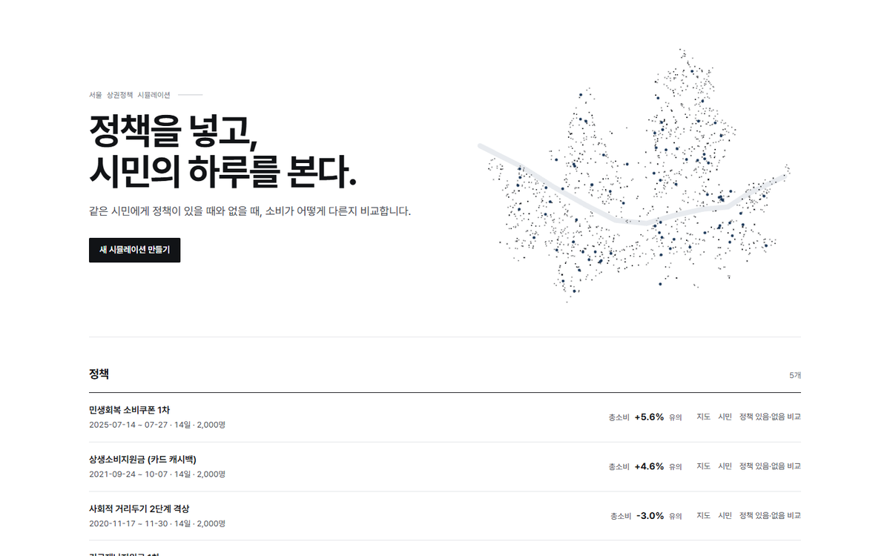

**누를 것**: 없음. 화면 아래 **정책** 목록이 보이게 조금 내린다.

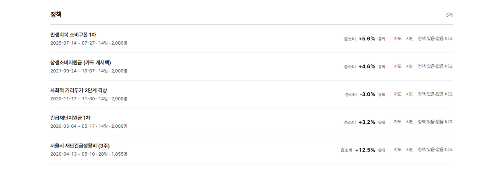

**짚을 곳**

- 오른쪽 점 지도: 합성 시민의 집 위치다.
- 정책 다섯 줄과 각 줄의 **총소비 효과**: +5.6%, +4.6%, −3.0%, +3.2%, +12.5%. 모두 "유의"다.

**말할 것**
> 서울 시민을 닮은 가상 시민 2,000명이 매일 어디 가서 무엇을 사는지 AI가 정합니다.
> 같은 시민을 두 번 돌립니다. 한 번은 정책이 있고, 한 번은 없습니다.
> 두 번의 차이가 정책 효과입니다.
> 지금까지 실제로 있었던 정책 다섯 개를 돌렸고, 오늘은 서울시 재난긴급생활비로 보여 드리겠습니다.

---

### 2단계. 3D 지도 — 시민이 움직인다 (1분 30초)

**누를 것**: **서울시 재난긴급생활비 (3주)** 줄 오른쪽의 **지도**.

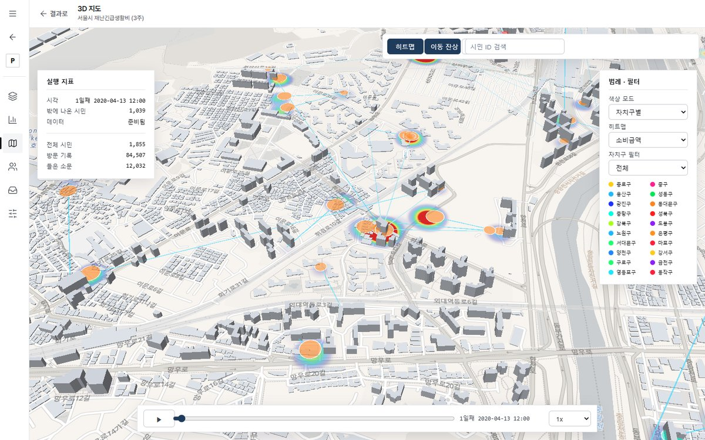

지도는 이 정책에서 가장 붐비는 곳(동대문구 회기·이문동, 외대 앞)에서 첫날 아침 7시부터 재생된다. 히트맵(소비 금액)과 이동 잔상이 켜져 있다.

**짚을 곳**

- 왼쪽 **실행 지표**:
  - 시각: 1일째 2020-04-13
  - 밖에 나온 시민: 첫날 정오 1,039명
  - 전체 시민: 1,855명
  - 방문 기록: 84,507
  - 들은 소문: 12,032
- 붉은 히트맵: 돈이 많이 쓰인 곳이다.
- 하늘색 선: 시민이 움직인 길이다.

**말할 것**
> 점 하나가 시민 한 명입니다. 점심 먹고, 장 보고, 집에 들어가는 하루가 시간대별로 움직입니다.
> 붉은 곳은 돈이 많이 쓰인 곳입니다.

**누를 것** (한 사람 따라가기)

1. 아래 재생 막대를 **9일째 2020-04-21 12:00** 근처로 끈다. 정책 시행(4/20) 다음 날 점심이다.
2. 위 **시민 ID 검색** 칸에 `AGT_11110700_F_70대이상_001` 을 넣고 Enter.

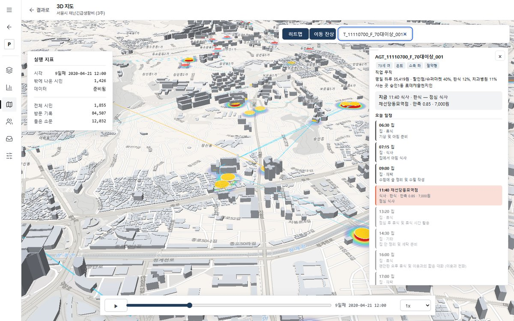

**짚을 곳** (오른쪽 패널)

- 73세 여성 · 은퇴 · 소득 하 · 절약형
- 평일 하루 35,419원. 할인점·슈퍼마켓 40%, 한식 12%
- **지금 11:40 채선당 동묘역점 · 한식 · 7,000원**
- 오늘 일정: 06:30 기상 → 09:00 수필 작성 → 11:40 점심 식사 → 13:20 휴식 …
- 왼쪽 실행 지표: 밖에 나온 시민 1,426명

**말할 것**
> 종로구 숭인동에 사는 73세 할머니입니다.
> 오늘 아침에 일어나 수필을 쓰고, 11시 40분에 동묘역 근처 한식집에서 7천 원짜리 점심을 드셨습니다.
> 이 일정과 결제를 AI가 이분의 성향과 남은 돈, 그날 기분을 보고 정했습니다.
> 잠시 뒤에 이분께 직접 물어보겠습니다.

---

### 3단계. 정책 있음·없음 비교 — 숫자 (1분 30초)

**누를 것**: 홈(왼쪽 위 ←)으로 돌아가 같은 줄의 **정책 있음·없음 비교**. 미리 연 탭 3을 써도 된다.

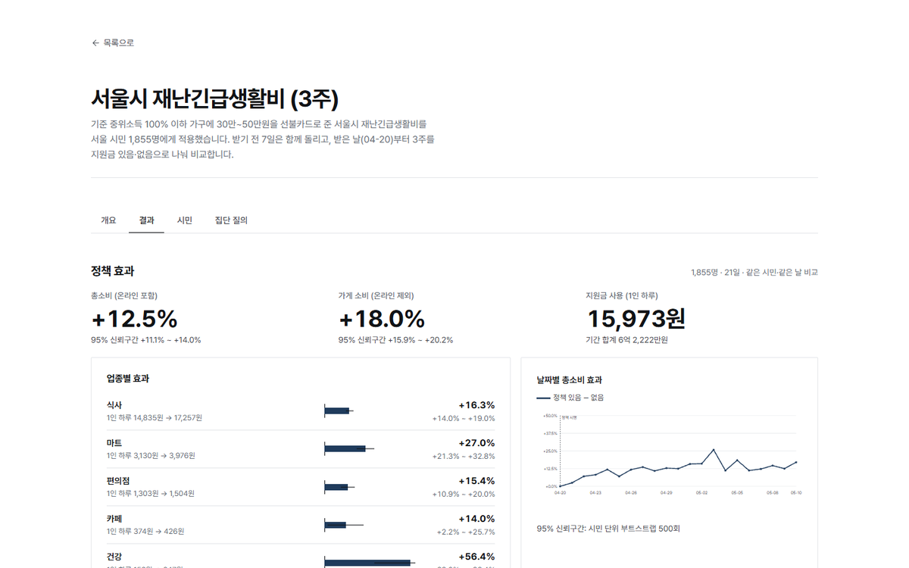

**짚을 곳** (위에서 아래로)

1. **총소비 +12.5%** (95% 신뢰구간 +11.1 ~ +14.0%)
2. **가게 소비 +18.0%** (온라인 제외)
3. **지원금 사용 1인 하루 15,973원**, 기간 합계 6억 2,222만원
4. **업종별 효과**:
   - 마트: 1인 하루 3,130원 → 3,976원, **+27.0%**
   - 식사: **+16.3%**
   - 편의점: **+15.4%**
   - 건강: **+56.4%** (금액은 158원 → 247원으로 작다)
5. **날짜별 총소비 효과**: 받은 날(4/20) 0에서 시작해 사흘 만에 +10% 안팎으로 오른다. 그 뒤로 대체로 +10 ~ +15%이고, 5월 3일에 +25%로 가장 높다.

**말할 것**
> 같은 1,855명, 같은 날짜입니다. 지원금이 있을 때 총소비가 12.5% 늘었습니다.
> 신뢰구간이 11%에서 14%라 우연이 아닙니다.
> 가장 크게 는 곳은 마트(27%)와 식당(16%)입니다. 생활비 지원이니 장보기와 끼니에 먼저 쓴 겁니다.

**누를 것**: 아래로 내려 **실측 연구와 비교** 카드를 보여 준다.

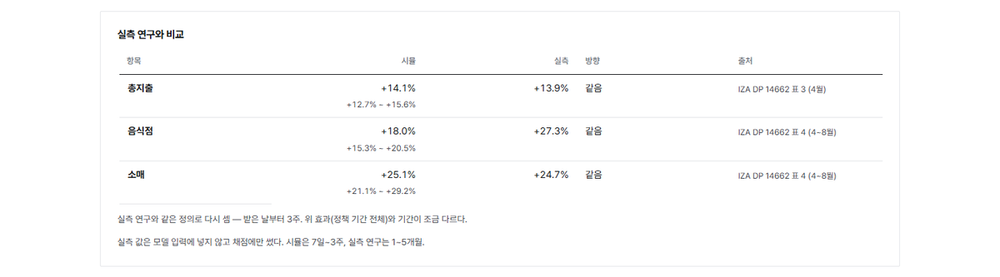

| 항목 | 시뮬 | 실측 | 방향 |
|---|---|---|---|
| 총지출 | **+14.1%** | **+13.9%** | 같음 |
| 음식점 | +18.0% | +27.3% | 같음 |
| 소매 | **+25.1%** | **+24.7%** | 같음 |

출처는 IZA DP 14662 (표 3·4)다.

**말할 것**
> 실제 서울 카드 데이터로 이 정책을 분석한 연구와 비교하면 총지출 14.1% 대 13.9%, 소매 25.1% 대 24.7%입니다.
> 중요한 건, 이 실측 숫자를 모델에 한 번도 보여 주지 않았다는 점입니다. 시뮬을 다 돌린 뒤 채점할 때만 썼습니다.

**주의**: 표의 +14.1%와 위의 +12.5%는 기간이 다르다. 표는 실측 연구와 같은 "받은 날부터 3주, 로그 차" 정의로 다시 센 값이고, 위는 정책 기간 전체 값이다. 카드 아래 회색 글씨에도 적혀 있다.

---

### 4단계. 시민 문답 · 여러 명 — 왜 그렇게 썼나 (1분 30초)

**누를 것**

1. 홈으로 돌아가 같은 줄의 **시민** 링크. 미리 연 탭 4를 써도 된다. (비교 화면 위쪽의 "시민" 탭은 다른 화면이니 누르지 않는다.)
2. 화면이 **여러 명에게**로 열린다(기본값).
3. 조건은 고르지 않는다(1,855명 전체).
4. 질문 버튼 **"재난긴급생활비를 받은 뒤 생활비 걱정이 줄었나요? 어디부터 쓰셨나요?"** 를 누른다. 질문 칸에 들어간다.
5. 표본 수 **6** 그대로 **묻기**. 6~10초 걸린다.

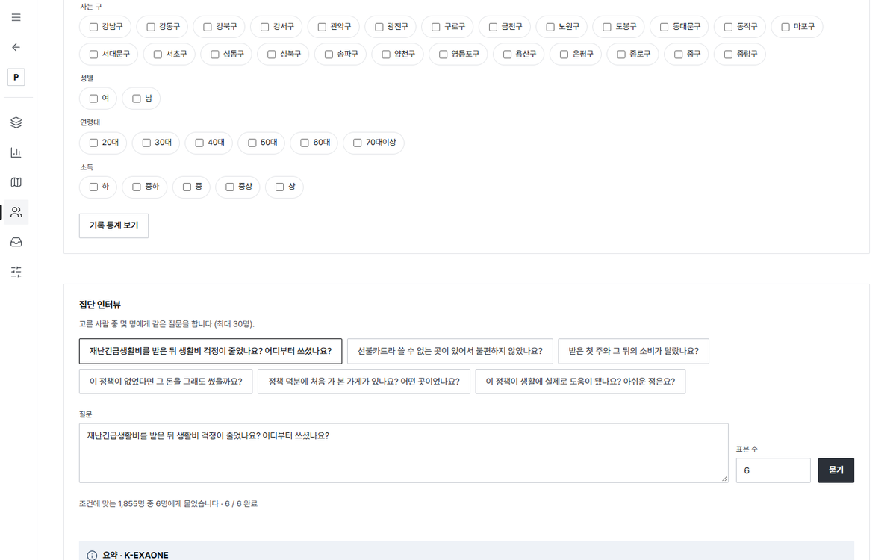

**나오는 것**: 맨 위에 **요약** 상자가 있고, 아래에 시민 6명의 답 카드가 있다.

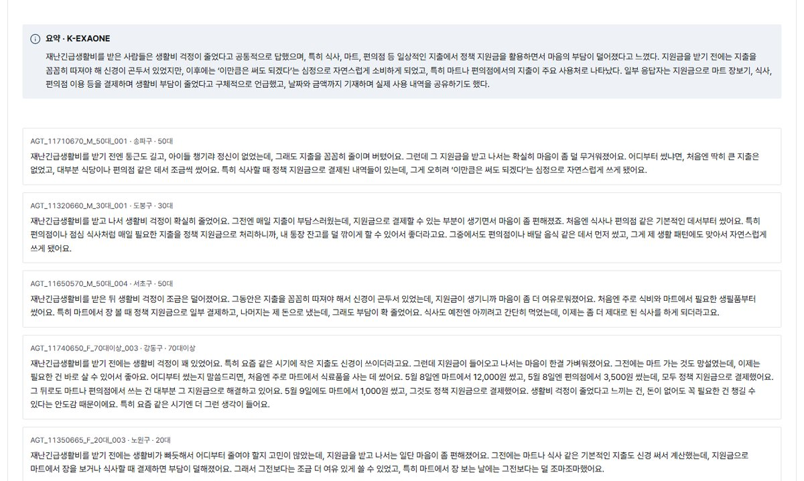

뽑히는 6명은 다음과 같다.

- 송파구 50대 남성
- 도봉구 30대 남성
- 서초구 50대 남성
- 강동구 70대 이상 여성
- 노원구 20대 여성
- 종로구 70대 이상 여성 (2단계 지도에서 본 그 시민)

**실제 답 (10/26)**

- 요약
  > 재난긴급생활비를 받은 사람들은 생활비 걱정이 줄었다고 공통적으로 답했으며, 특히 식사, 마트, 편의점 등 일상적인 지출에서 정책 지원금을 활용하면서 마음의 부담이 덜어졌다고 느꼈다. … 특히 마트나 편의점에서의 지출이 주요 사용처로 나타났다.
- 강동구 70대 여성
  > 처음엔 주로 마트에서 식료품을 사는 데 썼어요. 5월 8일엔 마트에서 12,000원 썼고, 5월 8일엔 편의점에서 3,500원 썼는데, 모두 정책 지원금으로 결제했어요.
- 종로구 70대 여성
  > 처음엔 주로 마트에서 장을 보는 데 썼어요. … 식사도 예전엔 한 끼만 먹고 말았는데, 이제는 두 끼 다 먹거나, 카페 같은 데도 가끔 가게 되더라고요.
- 송파구 50대 남성
  > 처음엔 딱히 큰 지출은 없었고, 대부분 식당이나 편의점 같은 데서 조금씩 썼어요.

**말할 것**
> 숫자로는 마트가 27% 늘었는데, 시민들한테 물어보니 실제로 "마트부터 썼다"고 답합니다.
> 숫자만 보면 "얼마나"만 알 수 있지만, 여기서는 "왜, 어떻게"까지 들을 수 있습니다.
> 답에 나오는 날짜와 금액은 그 시민의 실제 결제 기록에서 나옵니다. 기록에 없는 금액은 말하지 못하게 했습니다.

**한 번 더 (시간 있으면)**: 소득 **하** 를 체크하고(245명), 질문 버튼 **"이 정책이 없었다면 그 돈을 그래도 썼을까요?"** → **묻기**.

**실제 답 (10/26)**

- 서초구 70대 여성
  > 그 지원금이 없었다면 아마도 비슷한 금액 정도는 썼을 것 같아요.
- 도봉구 50대 여성
  > 정책 지원금으로 산 건 대부분 평소에 사야 했던 물건들이긴 했지만, 그 덕분에 현금을 더 오래 들고 있을 수 있었던 것 같아요.
- 동작구 20대 남성
  > 다만 그 지원금이 없었다면 다른 데서 아껴야 했을 텐데, 예를 들어 교통비나 식비를 더 줄이거나, 아르바이트를 더 하거나 했을 수도 있겠죠.

**말할 것**
> 지원금은 하루 1만 6천 원(15,973원)씩 썼는데, 총소비는 3,628원(28,951원 → 32,579원)만 늘었습니다.
> 지원금의 약 23%만 새 소비가 됐고, 나머지는 원래 쓸 돈을 대신한 겁니다.
> 시민들도 "어차피 사야 했던 물건"이라고 답합니다. 숫자와 인터뷰가 같은 이야기를 합니다.

---

### 5단계. 시민 문답 · 한 명 — 지도에서 본 그 사람 (1분)

**누를 것**

1. 오른쪽 위 **한 명에게**.
2. 왼쪽 **검색** 칸에 `AGT_11110700_F_70` 을 입력하고, 목록에 뜬 **AGT_11110700_F_70대이상_001** (종로구 숭인1동 · 70대이상 여성)을 누른다.
3. 아래 **물어보기 → 정책에 대해** 줄의 **"선불카드라 쓸 수 없는 곳이 있어서 불편하지 않았나요?"** 를 누른다.

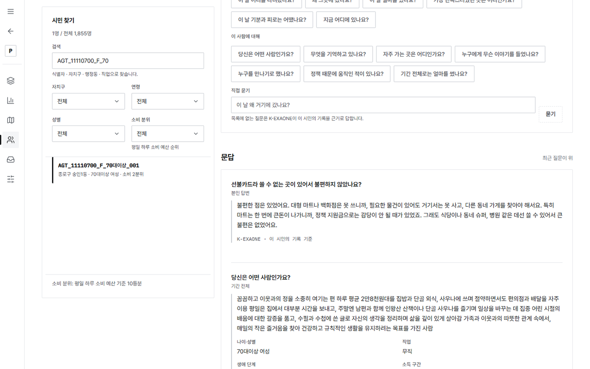

**실제 답 (10/26)**
> 불편한 점은 있었어요. 대형 마트나 백화점은 못 쓰니까, 필요한 물건이 있어도 거기서는 못 사고, 다른 동네 가게를 찾아야 해서요. 특히 마트는 한 번에 큰돈이 나가니까, 정책 지원금으로는 감당이 안 될 때가 있었죠. 그래도 식당이나 동네 슈퍼, 병원 같은 데선 쓸 수 있어서 큰 불편은 없었어요.

**말할 것**
> 아까 지도에서 동묘역 한식집에 가던 그 할머니입니다.
> 이 선불카드는 대형마트·백화점에서 못 씁니다. 그 규칙을 알고 동네 가게와 식당에서 썼다고 답합니다.
> 정책 담당자라면 "사용처 제한이 생활에 얼마나 불편했나"를 시행 전에 미리 들어 볼 수 있습니다.

**한 번 더 (시간 있으면)**: **"이 정책이 생활에 실제로 도움이 됐나요? 아쉬운 점은요?"**

> 이 정책 덕분에 일단 생활비 부담이 조금 덜어졌어요. … 아쉬운 점은, 지원금을 쓸 수 있는 곳이 제한돼 있다는 거예요. 백화점이나 대형마트, 온라인몰에서는 못 쓰니까, 필요한 물건을 살 때 가까운 동네 가게나 작은 마트를 돌아다녀야 해요.

---

### 6단계. 거리두기 — 규제에도 맞는다 (1분 30초)

**누를 것**: 홈 → **사회적 거리두기 2단계 격상** 의 **정책 있음·없음 비교**.

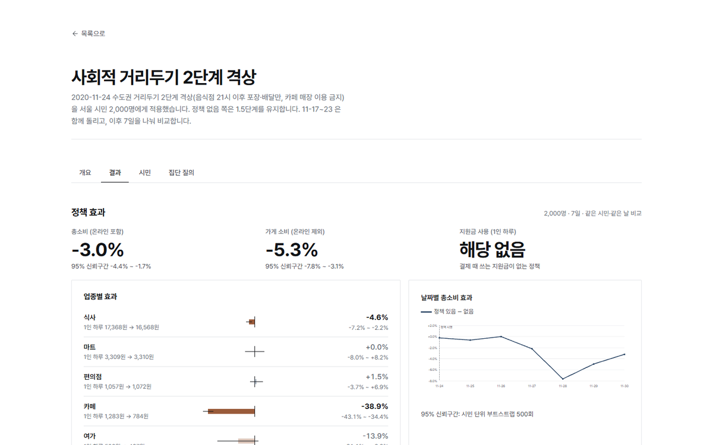

**짚을 곳**

- **총소비 −3.0%** (95% 구간 −4.4 ~ −1.7%)
- **가게 소비 −5.3%**
- 지원금 사용은 "해당 없음"이다. 규제 정책이기 때문이다.
- **카페 −38.9%**: 1인 하루 1,283원 → 784원. 막대가 가장 길다.
- **식사 −4.6%**. 마트는 +0.0%, 편의점은 +1.5%로 변화가 없다.
- **날짜별 총소비 효과**: 평일(11/24~26)에는 거의 0이다. 금요일 −2.2%를 지나 **토요일(11/28) −7.6%** 로 가장 깊게 떨어진다.

**말할 것**
> 이번엔 돈을 주는 정책이 아니라 막는 정책입니다. 식당은 밤 9시 이후 포장·배달만, 카페는 매장 이용 금지입니다.
> 카페 소비가 39% 줄었고, 마트·편의점은 그대로입니다.
> 날짜별로 보면 평일엔 차이가 거의 없다가 주말 저녁 외식이 막히는 토요일에 7.6%로 가장 크게 줄었습니다.

**누를 것**: 아래 **실측 연구와 비교** 카드.

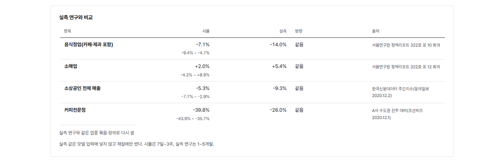

| 항목 | 시뮬 | 실측 | 방향 | 출처 |
|---|---|---|---|---|
| 음식점업(카페·제과 포함) | −7.1% | −14.0% | 같음 | 서울연구원 정책리포트 322호 |
| 소매업 | +2.0% | +5.4% | 같음 | 서울연구원 정책리포트 322호 |
| 소상공인 전체 매출 | −5.3% | −9.3% | 같음 | 한국신용데이터 |
| 커피전문점 | −39.8% | −26.0% | 같음 | 조선비즈 |

**말할 것**
> 네 항목 모두 방향이 맞습니다. 음식점은 줄고 소매는 늘었습니다. 크기는 실측의 절반에서 1.5배 사이입니다.

**누를 것** (시간 있으면): 홈 → 거리두기 줄의 **시민** 링크 → 질문 버튼 **"밤 9시 이후 식당 이용이 막힌 뒤 저녁은 어떻게 해결하셨나요?"** → **묻기**.

**실제 답 (10/26)**

- 강남구 20대 여성
  > 저는 밤 9시 이후에는 포장이나 배달만 가능하니까, 저녁은 미리 포장해서 집에서 먹거나 배달을 시켰어요.
- 관악구 20대 남성
  > 그런데 배달은 배달비가 좀 부담스러워서, 되도록이면 직접 포장하러 가는 편이에요. 가끔은 편의점에서 간단히 먹을 수 있는 걸로 끼니를 때우기도 하고요.
- 요약
  > … 배달비 부담을 줄이기 위해 직접 포장해 오는 선택을 하기도 한다.

연령대를 20·30대로 좁혀 **"카페 매장 이용이 막힌 뒤 그 시간을 어디서 보내셨나요?"** 를 물으면 이런 답이 나온다(712명 중 6명).
> 카페 매장 이용이 막힌 뒤엔 집에서 시간을 보냈어요. 집에서 차 마시거나 책 보는 정도로 지냈고, 특별히 외출할 일이 없으면 거의 집에 있었어요.

---

### 7단계. 보고서 — 들고 가는 결과물 (30초)

**누를 것**: 재난긴급생활비 실행으로 돌아가 왼쪽 메뉴 **보고서** → **만들어진 보고서** 맨 위.

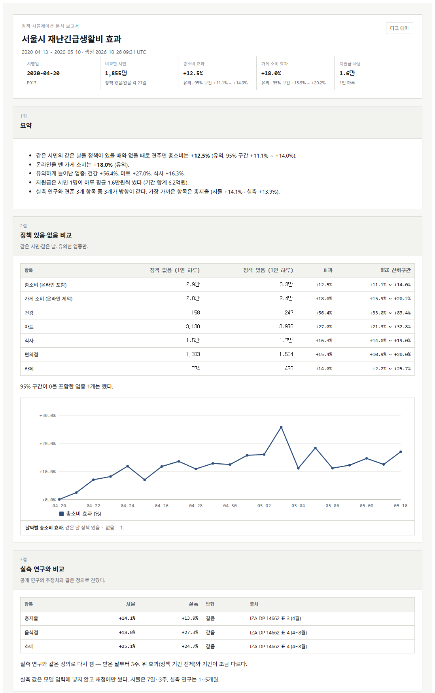

보고서는 네 절이다.

1. **요약**: 총소비 +12.5%, 유의하게 는 업종 셋, 지원금 하루 1.6만원, 실측 3개 중 3개 방향 일치
2. **정책 있음·없음 비교**: 유의한 업종만 싣고 날짜별 효과 그래프를 붙였다
3. **실측 연구와 비교**
4. **근거와 한계**

**말할 것**
> 정책 담당자가 그대로 보고에 쓸 수 있게 한 장으로 정리됩니다. 신뢰구간이 0을 지나는 업종은 뺐습니다.

**마무리 한 문장**
> 정책을 시행하기 전에 "누가, 어디서, 얼마나, 왜" 쓸지를 미리 보는 도구입니다. 실제 정책 다섯 개로 검증했고, 주요 업종에서 실측과의 상관이 0.91입니다.

---

## 3. 짧은 판 (3분)

1. 첫 화면 한마디 (15초)
2. 지도: 재생만 보여 주고 바로 넘어간다 (30초)
3. 재난긴급생활비 비교 화면 (1분)
   - 총소비 +12.5%, 마트 +27%
   - 실측 비교: 14.1% 대 13.9%
4. 시민 문답: 질문 버튼 하나 → 묻기 → 요약 한 줄 읽기 (1분)
5. 마무리: "주요 업종 상관 0.91, 실측은 입력에 넣지 않았다" (15초)

---

## 4. 예상 질문과 답

각 답 끝에 그 답을 받쳐 줄 화면을 적었다.

**Q1. 정확도가 얼마나 되나?**
- 지출의 95%를 차지하는 주요 업종 효과 14개에서, 시뮬과 실측의 상관이 **r = 0.91** (95% 구간 0.73 ~ 0.97)이다.
- 기울기는 1.09, 방향은 14개 모두 맞는다.
- 정책을 하나씩 빼고 다시 재도 0.74 ~ 0.92로, 특정 정책 하나에 기대지 않는다.
- 화면: 각 정책 비교 화면의 실측 연구와 비교 카드.

**Q2. 전체 업종으로 보면?**
- 27개 전체로는 r = 0.46이다. 숨기지 않는다.
- 소액 업종 13개만 보면 r = 0.12로 거의 못 맞힌다. 2,000명 중 그 업종에 돈을 쓴 사람이 적어서 신뢰구간이 넓다.
- 그래서 화면과 보고서에는 유의한 업종만 싣고, 몇 개를 뺐는지 적어 두었다.
- 화면: 업종별 효과의 옅은 막대(구간이 0을 포함).

**Q3. 정답을 보고 맞춘 것 아닌가?**
- 아니다. 실측 수치는 모델 입력과 프롬프트 어디에도 들어가지 않는다. 시뮬이 끝난 뒤 채점에만 썼다. 한국은행 수치도 채점용으로만 쓴다.
- 시민이 아는 것은 실제 정책 안내문뿐이다. 예: "대형마트·백화점에서는 못 씁니다".

**Q4. AI가 지어낸 답 아닌가? (시민 문답)**
- 시민은 자기 프로필과 그 기간의 실제 결제 기록만 받고 답한다.
- 답에 쓴 기록 번호를 함께 받아, 기록에 없는 숫자가 나오면 경고로 잡는다.
- 여러 명의 답을 묶은 요약은 "확인되지 않은 정리"로 따로 표시한다.
- 숫자(효과 %)는 모델이 쓴 것이 아니라 결제 기록에서 계산한 값이다.

**Q5. 같은 시민끼리 비교한다는 게 무슨 뜻인가?**
- 정책 전 1주는 한 번만 돌리고, 시행일부터 두 갈래로 나눈다. 한쪽은 정책이 있고, 한쪽은 없다.
- 같은 사람·같은 날의 소비를 나누므로 날씨·요일·개인 성향이 효과에 섞이지 않는다.
- 신뢰구간은 시민 단위로 500번 다시 뽑아 구했다.

**Q6. 시뮬 기간이 실측 연구와 다른데?**
- 시뮬은 7일~3주, 실측 연구는 1~5개월이다.
- 재난긴급생활비는 실측과 같은 정의(받은 날부터 3주)로 다시 셌다.
- 다른 정책은 기간 차이를 실측 비교 카드 아래에 적어 두었다.

**Q7. 상생소비지원금(카드 캐시백)은 왜 절반만 나오나?**
- 이 정책은 "2분기보다 3% 넘게 더 쓴 금액의 10%"를 돌려준다. 문턱을 넘었는지는 한 달을 다 써야 안다.
- 시뮬은 7일이라 대부분이 문턱에 닿기 전에 끝난다. 총소비는 시뮬 +4.6%, 실측 +11.3%다.
- 방향은 맞는다. 요식 +8.8% 대 +13.3%, 유통 +5.4% 대 +13.8%, 제외업종 +0.1% 대 +2.8%.

**Q8. 민생회복 소비쿠폰은 왜 크게 나오나?**
- 쿠폰 사용처 효과가 시뮬 +13.4%, 실측 +4.9%로 약 2.7배다.
- 시뮬 시민은 쿠폰을 실제보다 3배쯤 빨리 써 버린다. 7일 창에 돈이 몰려 크게 잡힌다. 다음 과제로 남겼다.

**Q9. 지원금 1원이 소비를 얼마나 늘리나?**
- 화면의 "1인 하루" 금액으로 바로 셀 수 있다.
  - 긴급재난지원금: 지원금 하루 4,803원 사용, 총소비 1,410원 증가 → **0.29**
  - 서울시 재난긴급생활비: 15,973원 사용, 3,628원 증가 → **0.23**
- KDI(2020) 실측은 1차 긴급재난지원금의 카드매출 증가가 투입재원의 **26.2~36.1%** 다.
- 단, 분모가 다르다(시뮬은 "쓴 지원금", KDI는 "투입재원"). 같은 자로 잰 값이 아니라 크기가 비슷하다는 참고로만 말한다.

**Q10. 시민 데이터는 어디서 왔나? 개인정보는?**
- 서울시 빅데이터캠퍼스 데이터를 참조해 반출 기준에 맞추어 합성한 가상 시민 15,000명이다. 실제 개인은 없다.
- 데이터셋은 허깅페이스에 공개했다: `mimseong/seoul-synthetic-personas-15k`.

**Q11. 2,000명으로 서울을 말할 수 있나? 왜 재난긴급생활비는 1,855명인가?**
- 정책마다 그 시점 서울 주민등록 분포(동·성별·연령)에 맞춰 15,000명 중 2,000명을 뽑았다.
- 재난긴급생활비는 실제 신청자의 성·연령에 맞춰 뽑았다. 40대 후보가 모자라 2,000명 목표에서 1,855명이 됐다.
- 총소비·주요 업종은 95% 구간이 ±1.5%p 안팎으로 좁다. 소액 업종은 더 많은 시민이 필요하다. 이것이 지금 가장 큰 한계다.

**Q12. 어떤 모델을 쓰나?**
- 시민의 하루 계획과 결제 결정: LG AI연구원 EXAONE-4.5-33B.
- 화면의 시민 문답: 같은 EXAONE 계열인 K-EXAONE API.

**Q13. 거리두기에서 카페는 −39%인데 실측은 −26%다. 과하지 않나?**
- 방향은 맞고 크기는 1.5배다.
- 반대로 음식점업 전체는 −7.1% 대 −14.0%로 작게 나온다.
- 시뮬은 시행 직후 7일만 봤고 실측은 그보다 긴 기간이라, 크기는 이 범위에서 흔들린다. 네 항목 모두 방향은 같다.

**Q14. 시간과 비용은 얼마나 드나?**
- 재난긴급생활비 3주 연장분 기준: 1,855명 × 두 갈래 × 14일 = 51,940 사람-날.
- 58.2시간 걸렸고, 모델 호출 139,584번, 토큰은 입력 7.15억·출력 1.20억이다.
- 출처: `P017_서울시_재난긴급생활비/data/experiments/RUN_COST_ACCOUNTING_20261009.md`.

**Q15. 실제 담당자는 이걸 어디에 쓰나?**
- 시행 전에 "어느 업종·어느 동네로 돈이 흘러가는가"를 미리 본다.
- 예: 거리두기에서 카페가 −39%로 가장 크게 준다 → 카페 업종 지원을 먼저 설계한다.
- 사용처 제한 같은 규칙이 시민에게 얼마나 불편한지 시민 문답으로 미리 들어 본다.

---

## 5. 사고 대비

| 상황 | 할 일 |
|---|---|
| 묻기가 20초 넘게 안 끝남 | 미리 열어 둔 탭 4(이미 답이 있는 화면)로 넘어간다. "모델 서버가 붐비네요, 아까 받아 둔 답으로 보겠습니다." |
| "요약 실패"가 뜸 | 아래 시민 답 카드는 그대로 있다. 카드 두 개를 읽는다. |
| 3D 지도가 회색으로 안 뜸 | 새로고침 한 번. 그래도 안 되면 넘어가고 비교 화면부터 한다. 시민 문답에서 같은 시민을 찾으면 이야기가 이어진다. |
| 화면 전체가 안 뜸 | 서버가 꺼진 것이다. 터미널에서 `bash run_console.sh` 를 다시 실행한다. 10초 안에 뜬다. |
| 시민 답에 어색한 문장이 섞임 | 그대로 둔다. "모델 답은 그대로 보여 드립니다. 숫자는 이 답이 아니라 결제 기록에서 계산합니다." |

---

## 6. 외울 숫자

| 정책 | 총소비 | 눈에 띄는 업종 | 실측과 |
|---|---|---|---|
| 서울시 재난긴급생활비 | **+12.5%** | 마트 +27.0%, 식사 +16.3% | 총지출 14.1 대 **13.9**, 소매 25.1 대 **24.7** |
| 거리두기 2단계 | **−3.0%** | 카페 −38.9%, 토요일 −7.6% | 4개 항목 방향 모두 같음 |
| 긴급재난지원금 1차 | +3.2% | 마트 +12.9%, 편의점 +10.5% | 음식업 2.7 대 3.0, 지원금 1원당 0.29 (KDI 0.26~0.36) |
| 상생소비지원금 | +4.6% | 편의점 +17.3%, 카페 +15.3% | 총소비 4.6 대 11.3 (절반) |
| 민생회복 소비쿠폰 | +5.6% | 마트 +25.6%, 편의점 +20.9% | 사용처 13.4 대 4.9 (2.7배) |

**전체**: 주요 업종 14개 효과 r = **0.91**, 방향 14/14. 전체 27개 r = 0.46.
