# 시연 설계 — 정책별로 무엇을 보여 주고 무엇을 말하나

심사위원이 받아야 할 인상은 하나다.

> "이 도구는 정책을 시행하기 전에, **누가 · 어디서 · 얼마나 · 왜** 반응할지 보여 준다. 그리고 그 숫자가 실제 연구와 맞는다."

모든 정책을 같은 세 걸음으로 보여 준다. 정책 담당자가 실제로 묻는 순서다.

| 걸음 | 화면 | 담당자의 질문 | 보여 줄 것 |
|---|---|---|---|
| 1 | **결과** 위쪽 | 효과가 있었나? 얼마나? | 총소비 효과 %, 업종별 효과, 지원금 1원당 늘어난 소비 |
| 2 | **결과 → 누가 반응했나** | 누가 반응했고 누가 안 했나? | 연령대·소득별 효과 막대, 가장 큰·작은 집단 한 줄 |
| 3 | **시민 인터뷰** (집단에게) | 왜 그렇게 반응했나? | 그 집단 효과가 바로 바뀌는 숫자 + 그 집단 시민 6명의 답 |

1·2는 거시(숫자)이고, 3은 미시(사람)다. 3에서 고른 집단의 숫자와 그 집단의 말이 같은 이야기를 할 때 심사위원이 납득한다. 그 장면을 정책마다 하나씩 골라 두었다.

숫자는 모두 콘솔 화면과 평가표(`평가_통합성능/pairs_grouped.csv`)에서 그대로 옮겼다. 시민 답은 10월 27일 화면에서 같은 버튼을 눌러 받은 실제 응답이다. 같은 조건이면 같은 6명이 뽑히지만 문장은 매번 조금씩 다르다(모델 온도 0.4). 인용은 예시로 보고 흐름이 같은지만 확인한다.

---

## 0. 화면이 이렇게 바뀌었다

- **홈 정책 목록**: 줄마다 **결과 · 지도 · 시민 인터뷰** 링크가 있고, 정책 이름을 누르면 결과로 간다.
- **결과**: 정책 효과 → 누가 반응했나 → 결제 기록 → 실측 연구와 비교 순서다.
  - 결제 기록 칸에는 총 결제액, 지원금 결제액, 1인 하루 결제, 지원금 사용처 결제 비율, 일별 결제 추이, 업종별 결제액, 일자별 표가 있다.
  - 소비 분위 표만 뺐다.
- **누가 반응했나**: 연령대 · 소득 · 성별 단추로 축을 바꾼다. 줄마다 **이 집단에게 묻기** 단추가 있다.
- **시민 인터뷰**: 처음부터 **집단에게**로 열린다.
  - 맨 위 **정책 담당자 질문** 카드 다섯 장은 "누구에게 · 무엇을 · 왜" 묶음이다. 한 장을 누르면 집단과 질문이 함께 채워진다.
  - 집단을 바꾸면 **그 집단의 정책 효과**가 0.2초 안에 다시 계산된다.
  - 인터뷰는 늘 정책 시행 뒤 기록으로 한다. 날짜를 고르는 칸은 없앴다.
- **한 명에게**: 날짜·시간대 선택, 기억·소문 같은 기록 조회 질문, 소비 분위를 뺐다. 정책 질문과 직접 묻기만 남겼다.
- **보고서**: 요약 · 정책 있음·없음 비교 · **누가 반응했나** · 실측 비교 · 근거와 한계. 다섯 정책 모두 미리 만들어 두었다.

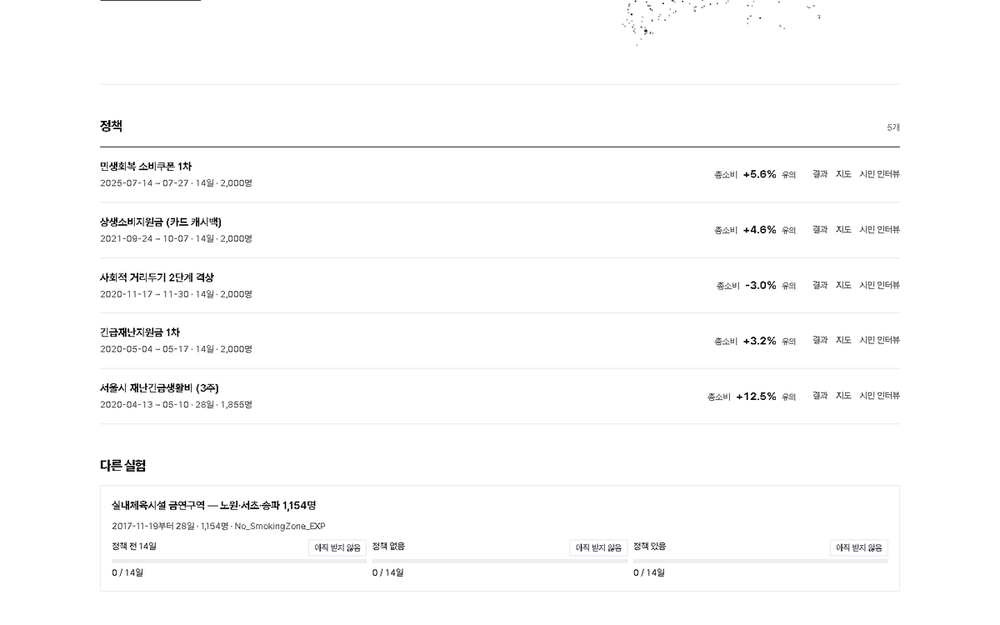

---

## 1. 시연 전 준비 (30분 전)

1. **서버를 켠다.** Claude Code 밖의 터미널에서 실행한다. Claude Code 안에서 켜면 메모리가 부족할 때 꺼질 수 있다.
   - 명령: `bash run_console.sh` (데이터 폴더 `kw_web_data`)
   - `Uvicorn running on http://127.0.0.1:8765` 가 뜨면 된다.
2. **모델 연결을 확인한다.** 보고서 화면 → 해설 모델 → **연결 확인**. "응답 확인"이 떠야 인터뷰가 된다.
3. **탭을 미리 연다.** 인터뷰가 느릴 때 넘어가기 위해서다. 각 정책의 첫 인터뷰 카드는 미리 한 번 눌러 답을 받아 둔다.
   - 정책별 결과: `/runs/P017/results`, `/runs/DIST2020/results`, `/runs/P013/results`, `/runs/P010/results`, `/runs/P012/results`
   - 시민 인터뷰: `/runs/P017/agents`, `/runs/DIST2020/agents`
4. **보고서**: 이 PC에는 다섯 정책 보고서를 만들어 두었다. 발표 노트북이 다르면 실행마다 **보고서 → 보고서 생성**을 한 번씩 누른다(정책 하나에 1분 안팎).
5. **브라우저**: 확대 100%, 창 너비 1440 안팎.

---

## 2. 정책별 설계

정책을 보여 줄 순서는 다음과 같다.

1. **서울시 재난긴급생활비** — 실측과 가장 잘 맞고, 집단 차이가 뚜렷하다.
2. **거리두기 2단계** — 돈을 주는 정책이 아니라 규제도 맞힌다.
3. **상생소비지원금(캐시백)** — 정책 *설계*의 결함을 시민 말로 찾아낸다.

시간이 남으면 긴급재난지원금과 민생회복 소비쿠폰을 덧붙인다.

---

### 2-1. 서울시 재난긴급생활비 (P017) — 주인공

**한 줄 결론**
> 총소비가 12.5% 늘었고, 실측 연구(13.9%)와 거의 같습니다. 그런데 모두가 똑같이 반응하지 않았습니다. 70대 이상은 19.5%, 30대는 9.1%입니다. 시뮬은 그 이유까지 들려줍니다.

#### 화면 1 — 결과 위쪽

홈 → **서울시 재난긴급생활비 (3주)** 를 누른다.

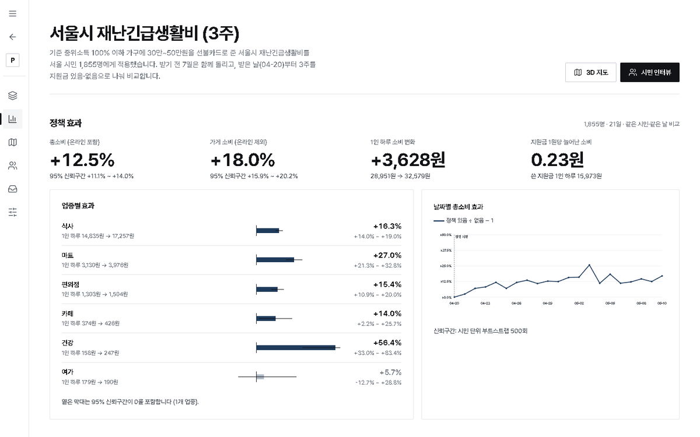

| 짚을 곳 | 값 | 말할 것 |
|---|---|---|
| 총소비 | **+12.5%** (95% 구간 +11.1 ~ +14.0) | 같은 1,855명을 지원금이 있을 때와 없을 때로 두 번 돌렸습니다. |
| 1인 하루 소비 변화 | **+3,628원** (28,951 → 32,579원) | 하루 3,600원을 더 썼습니다. |
| 지원금 1원당 늘어난 소비 | **0.23원** (쓴 지원금 하루 15,973원) | 지원금 1원 중 0.23원만 새 소비가 됐고, 나머지는 원래 쓸 돈을 대신했습니다. |
| 업종별 효과 | 마트 **+27.0%**, 식사 +16.3%, 편의점 +15.4% | 생활비 지원이니 장보기와 끼니에 먼저 갔습니다. |

#### 화면 2 — 누가 반응했나 (연령대)

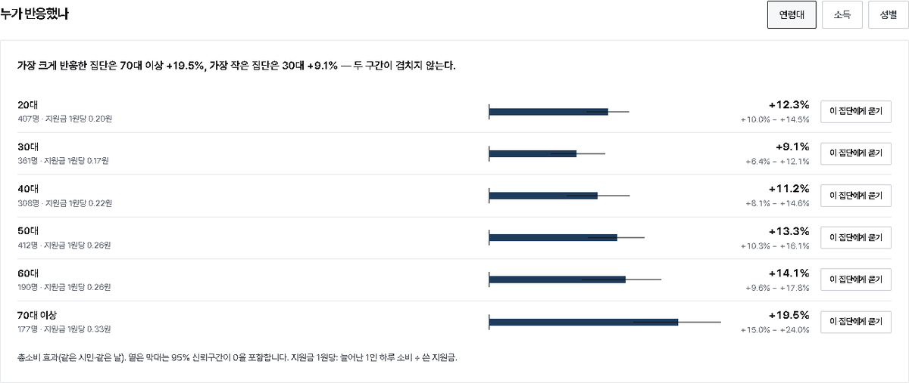

| 짚을 곳 | 값 |
|---|---|
| 첫 줄 | "가장 크게 반응한 집단은 70대 이상 +19.5%, 가장 작은 집단은 30대 +9.1% — 두 구간이 겹치지 않는다." |
| 70대 이상 | +19.5% [+15.0, +24.0], **지원금 1원당 0.33원** |
| 30대 | +9.1% [+6.4, +12.1], **지원금 1원당 0.17원** |
| 소득 단추를 누르면 | 소득 하 +15.6%, 소득 상 +9.5% |

**말할 것**
> 같은 돈을 줘도 70대 이상은 1원당 0.33원을 새로 쓰고, 30대는 0.17원만 씁니다. 두 배 차이입니다. 소득도 낮을수록 반응이 큽니다. 예산이 한정돼 있다면 누구에게 먼저 줄지를 시행 전에 정할 수 있습니다.

#### 화면 2-1 — 결제 기록 (질문이 나오면)

"누가 반응했나" 아래 **결제 기록** 칸이다. 정책 있음 실행의 원래 결제 숫자를 보여 준다. 정책 전 7일이 포함된다.

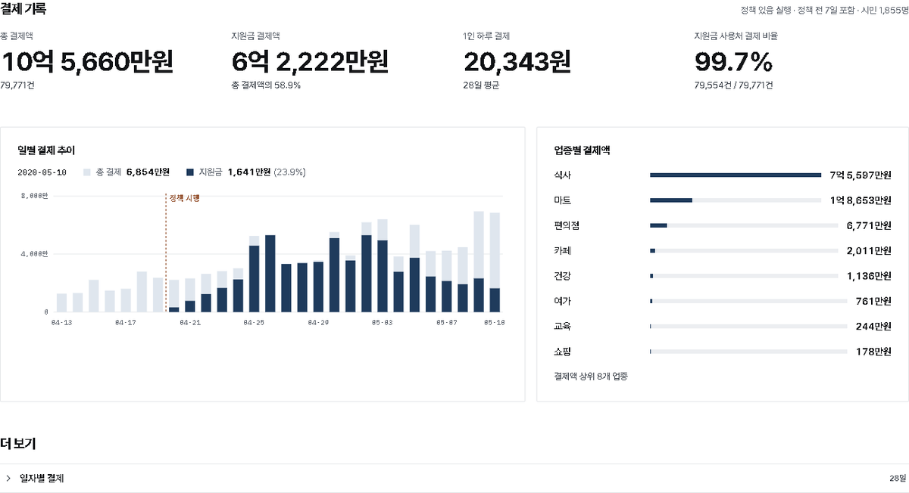

| 짚을 곳 | 값 |
|---|---|
| 총 결제액 | 10억 5,660만원 (79,771건) |
| 지원금 결제액 | 6억 2,222만원, 총 결제액의 58.9% |
| 1인 하루 결제 | 20,343원 (28일 평균) |
| 지원금 사용처 결제 비율 | 99.7% — 쓸 수 없는 곳(대형마트·온라인)에서의 결제가 거의 없다 |
| 일별 결제 추이 | 정책 시행선 뒤로 짙은 막대(지원금)가 커진다 |

> 시뮬 속 1,855명이 3주 동안 결제한 기록이 8만 건입니다. 그중 지원금으로 낸 몫이 이렇게 보입니다.

#### 화면 3 — 그 집단에게 묻기

70대 이상 줄의 **이 집단에게 묻기**를 누른다. 시민 인터뷰가 그 집단을 골라 둔 채 열린다. 그다음 맨 위 카드 **"70대 이상 · 효과가 가장 큰 집단 — 재난긴급생활비를 받고 나서 전에는 못 하던 지출을 한 게 있나요?"** 를 누르고 **묻기**를 누른다. 6~10초 걸린다.

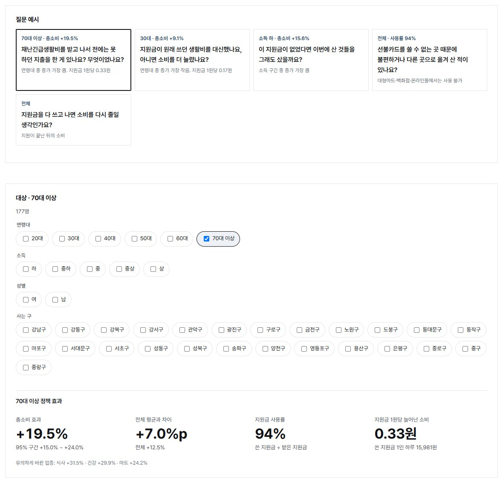

카드를 누르는 순간 아래 숫자가 바뀐다.

- 177명
- 총소비 **+19.5%**, 전체 평균보다 **+7.0%p**
- 가게 소비 +28.1%
- 1원당 0.33원
- 유의하게 바뀐 업종: 식사 +31.5% · 건강 +29.9% · 마트 +24.2%

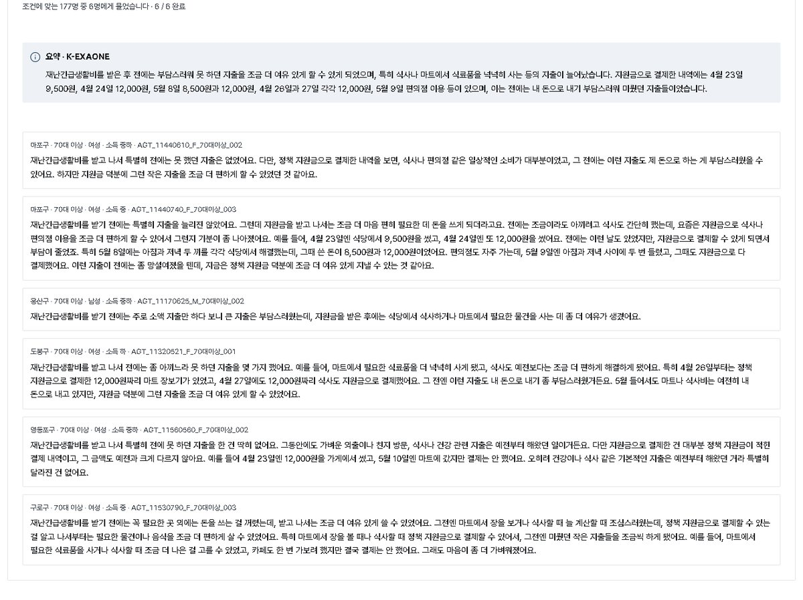

**실제 답 (10/27)**
- 구로구 70대 여성
  > 재난긴급생활비를 받기 전에는 꼭 필요한 곳 외에는 돈을 쓰는 걸 꺼렸는데, 받고 나서는 조금 더 여유 있게 쓸 수 있었어요. … 그전엔 미뤘던 작은 지출들을 조금씩 하게 됐어요.
- 도봉구 70대 여성
  > 마트에서 필요한 식료품을 더 넉넉히 사게 됐고, 식사도 예전보다는 조금 더 편하게 해결하게 됐어요.
- 마포구 70대 여성
  > 전에는 조금이라도 아끼려고 식사도 간단히 했는데, 요즘은 지원금으로 식사나 편의점 이용을 조금 더 편하게 할 수 있어서 …

**대조 장면 (시간 있으면)**: 카드 **"30대 · 효과가 가장 작은 집단 — 지원금이 원래 쓰던 생활비를 대신했나요, 아니면 소비를 더 늘렸나요?"** → **묻기**.
- 도봉구 30대 남성
  > 지원금이 원래 쓰던 생활비를 대체한 느낌이에요. … 특별히 더 사고 싶었던 걸 산 건 아니고, 평소에 하던 소비 패턴 안에서 지원금을 썼어요.
- 동작구 30대 남성
  > 지원금이 원래 쓰던 생활비를 대신한 것 같아요. 외식이나 편의점 같은 데서 쓰는 건 평소에도 하던 소비라서 …

**결과 분석 — 집중해서 말할 것**
- 숫자(1원당 0.33 대 0.17)와 말("미뤘던 지출을 했다" 대 "원래 생활비를 대신했다")이 같은 방향이다.
- 시뮬이 집단 차이를 지어낸 것이 아니라, 시민 한 명 한 명의 결정이 모여서 그 차이가 나온 것이다.

**강조할 것 (실용성)**
- 시행 전에 **지급 대상 우선순위**를 정할 근거가 된다. 같은 예산으로 소비 효과를 키우려면 고령·저소득부터 준다.
- 사용처 제한(대형마트 불가) 때문에 돈이 **동네 마트·식당**으로 갔다. 마트 +27%, 식사 +16%.

**실측 비교로 마무리**

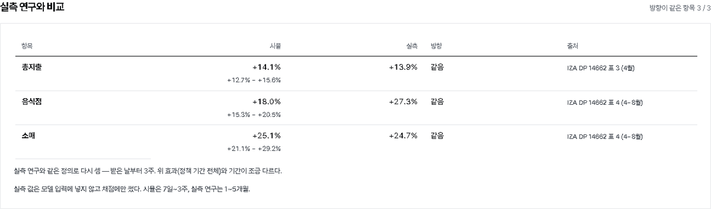

| 항목 | 시뮬 | 실측 |
|---|---|---|
| 총지출 | **+14.1%** | **+13.9%** |
| 소매 | **+25.1%** | **+24.7%** |
| 음식점 | +18.0% | +27.3% |

출처는 IZA DP 14662 (표 3·4)다.

> 실측 수치는 모델에 한 번도 넣지 않았습니다. 시뮬을 다 돌린 뒤 채점에만 썼습니다.

표의 +14.1%는 실측과 같은 정의(받은 날부터 3주, 로그 차)로 다시 센 값이다. 위의 +12.5%는 정책 기간 전체 값이다.

**보고서 (마무리 10초)**: 왼쪽 메뉴 **보고서** → 맨 위 보고서. "누가 반응했나" 표가 들어 있다.

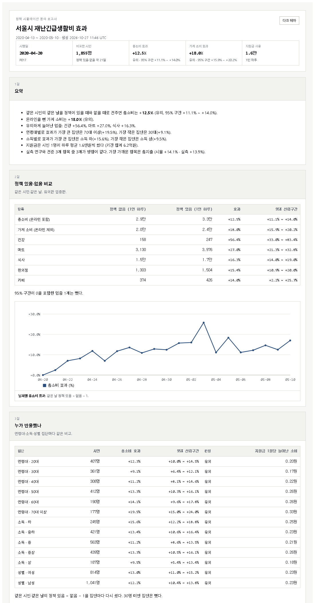

**지도 (시간 있으면, 30초)**: 홈 줄의 **지도** → 재생 막대를 9일째 4/21 12:00으로 옮기고, 시민 ID `AGT_11110700_F_70대이상_001` 을 검색한다. 종로구 73세 여성이 11:40에 동묘역 한식집에서 7,000원짜리 점심을 먹는다. "70대 이상 한 분의 하루"로 화면 3과 잇는다.

---

### 2-2. 거리두기 2단계 (DIST2020) — 규제도 맞힌다

**한 줄 결론**
> 돈을 주는 정책이 아니라 막는 정책입니다. 카페가 39% 줄고 마트는 그대로입니다. 실측 4개 항목 모두 방향이 맞습니다. 가장 크게 위축된 건 70대 이상입니다.

#### 화면 1 — 결과

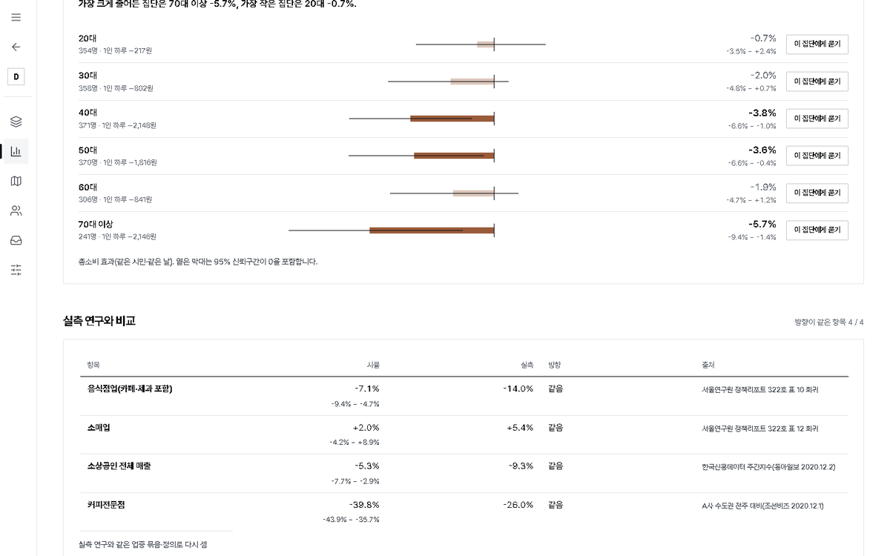

| 짚을 곳 | 값 | 말할 것 |
|---|---|---|
| 총소비 | **−3.0%** [−4.4, −1.7] | 서울 전체 소비가 3% 줄었습니다. |
| 1인 하루 소비 변화 | −1,304원 | |
| 업종별 | 카페 **−38.9%** (1,283원 → 784원), 식사 −4.6%, 마트 +0.0% | 매장 이용이 막힌 카페가 직격탄입니다. |
| 날짜별 | 평일(11/24~26) 거의 0 → 금 −2.2% → **토요일 −7.6%** | 주말 저녁 외식이 막히는 토요일에 가장 크게 줄었습니다. |

#### 화면 2 — 누가 반응했나 (연령대)

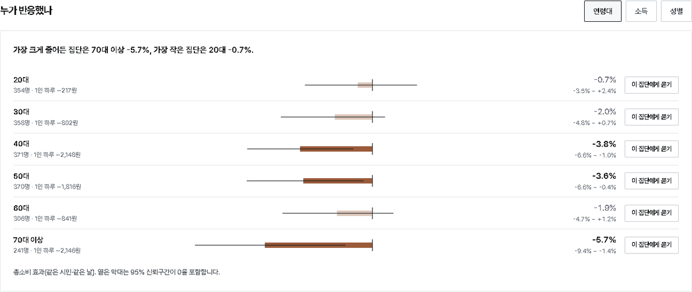

| 짚을 곳 | 값 |
|---|---|
| 첫 줄 | "가장 크게 줄어든 집단은 70대 이상 −5.7%, 가장 작은 집단은 20대 −0.7%." |
| 70대 이상 | −5.7% [−9.4, −1.4] 유의 |
| 40·50대 | −3.8%, −3.6% 유의 |
| 20대 | −0.7% (유의하지 않음) |

#### 화면 3 — 70대 이상에게 묻기

카드 **"70대 이상 · 가장 크게 줄어든 집단 — 거리두기 2단계 이후 아예 안 하게 된 외출이나 소비가 있나요?"** → **묻기**.

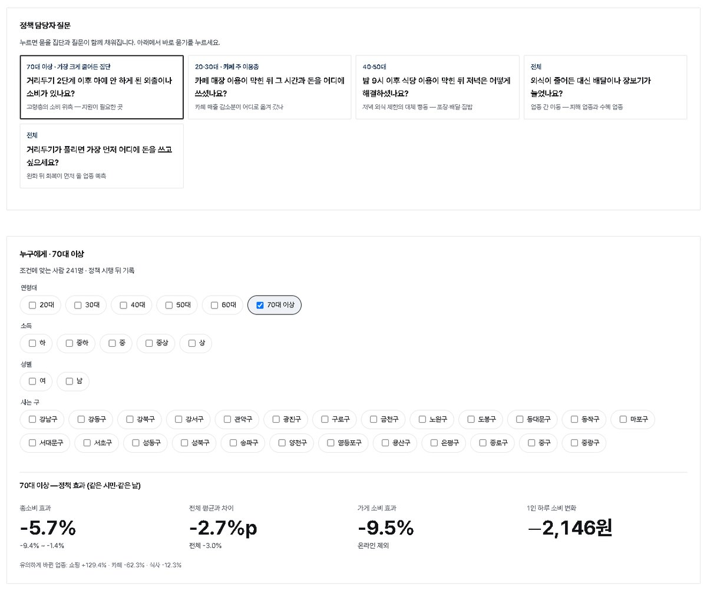

카드를 누르면 숫자가 바뀐다: 241명, 총소비 −5.7%. 유의하게 바뀐 업종은 쇼핑 +129.4% · 카페 −62.3% · 식사 −12.3% 순으로 보인다. 쇼핑은 원래 금액이 아주 작은 업종이라 비율이 크게 튄 것이다. 짚지 말고 카페·식사만 말한다. 물으면 그대로 설명한다.

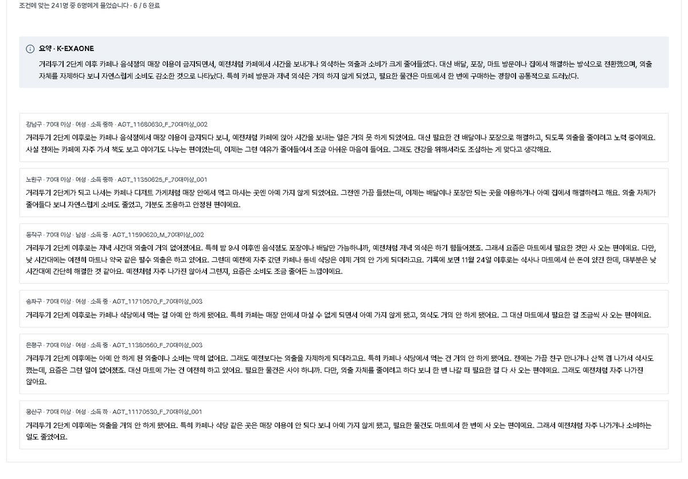

**실제 답 (10/27)**
- 용산구 70대 여성
  > 거리두기 2단계 이후에는 외출을 거의 안 하게 됐어요. 특히 카페나 식당 같은 곳은 매장 이용이 안 되다 보니 아예 가지 않게 됐고, 필요한 물건도 마트에서 한 번에 사 오는 편이에요.
- 동작구 70대 남성
  > 밤 9시 이후엔 음식점도 포장이나 배달만 가능하니까, 예전처럼 저녁 외식은 하기 힘들어졌죠. 그래서 요즘은 마트에서 필요한 것만 사 오는 편이에요.
- 강남구 70대 여성
  > 전에는 카페에 자주 가서 책도 보고 이야기도 나누는 편이었는데, 이제는 그런 여유가 줄어들어서 조금 아쉬운 마음이 들어요.

**대조 장면**: 카드 **"20·30대 · 카페 주 이용층 — 카페 매장 이용이 막힌 뒤 그 시간과 돈을 어디에 쓰셨나요?"**
- 집단 효과: 712명, 총소비 −1.5% (유의하지 않음), 그런데 카페 **−37.0%**
- 관악구 30대 남성
  > 카페 매장 이용이 안 되니까 집에서 커피 마시는 데 익숙해졌어요. … 그 시간에 편의점에서 간식이나 음료를 사서 집에서 먹는 데 돈을 썼어요.

**결과 분석 — 집중해서 말할 것**
- 젊은 층은 카페 대신 편의점·집으로 **옮겨 가서** 총소비가 거의 그대로다.
- 고령층은 **외출 자체를 접어서** 총소비가 줄었다.
- 같은 규제라도 집단마다 반응 경로가 다르다.

**강조할 것 (실용성)**
- 규제의 **피해 업종(카페·식당)과 수혜 업종(편의점·마트)**을 시행 전에 가린다. 손실보상 대상을 정할 근거가 된다.
- 고령층의 외출 위축은 소비 문제를 넘어 돌봄·고립 문제로 이어질 수 있다. 시민 말에서 먼저 드러난다.

**실측 비교**

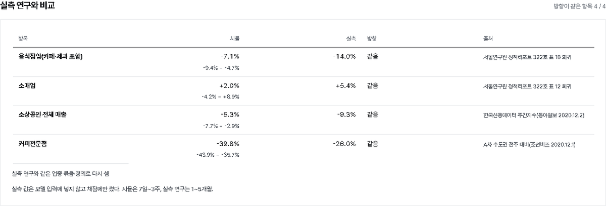

| 항목 | 시뮬 | 실측 | 출처 |
|---|---|---|---|
| 음식점업(카페·제과 포함) | −7.1% | −14.0% | 서울연구원 322호 |
| 소매업 | +2.0% | +5.4% | 서울연구원 322호 |
| 소상공인 전체 매출 | −5.3% | −9.3% | 한국신용데이터 |
| 커피전문점 | −39.8% | −26.0% | 조선비즈 |

> 네 항목 모두 방향이 맞습니다. 음식점은 줄고 소매는 늘었습니다.

---

### 2-3. 상생소비지원금 · 카드 캐시백 (P012) — 설계의 허점을 찾는다

**한 줄 결론**
> 효과는 실측의 절반(4.6% 대 11.3%)입니다. 대신 이 정책이 **고령층에게는 아무 효과가 없다**는 것과 그 이유를 시민 말로 찾아냅니다. 이게 정책 설계에 쓰는 법입니다.

#### 화면 1 — 결과

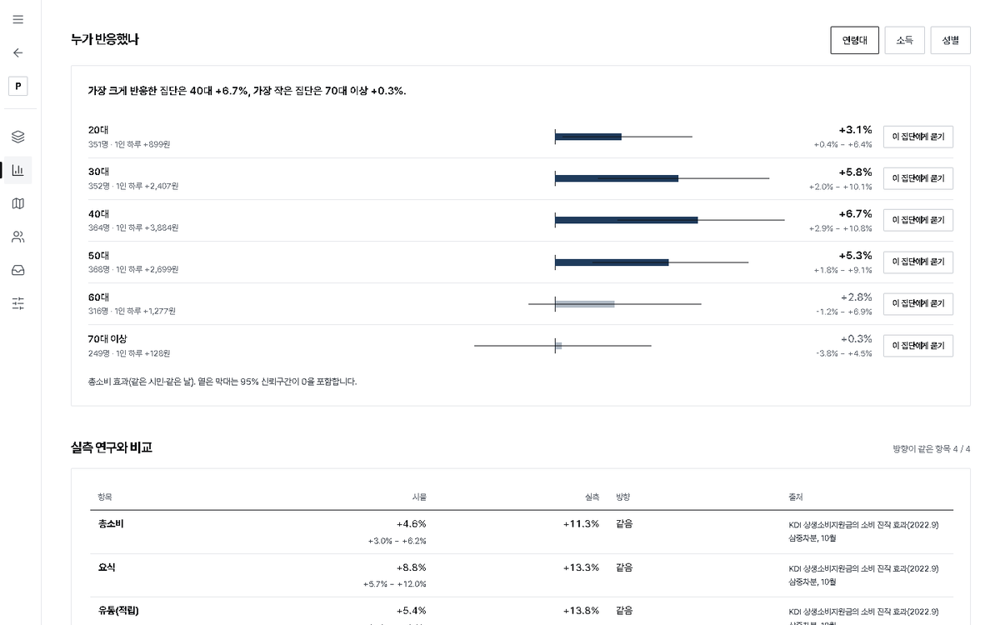

- 총소비 **+4.6%** [+3.1, +6.3], 가게 소비 +7.7%
- 편의점 +17.3%, 카페 +15.3%, 식사 +8.6%, 여가 −24.4%
- 지원금은 "해당 없음"이다. 캐시백은 다음 달에 돌려주기 때문이다.

#### 화면 2 — 누가 반응했나 (연령대)

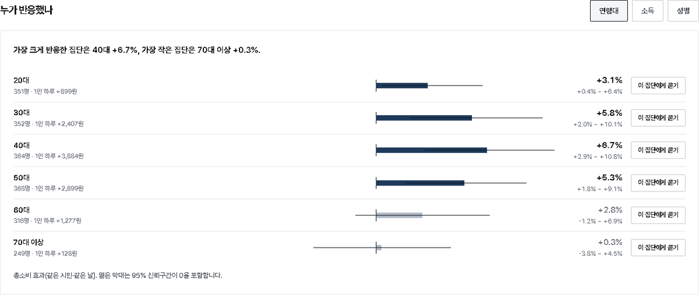

| 짚을 곳 | 값 |
|---|---|
| 첫 줄 | "가장 크게 반응한 집단은 40대 +6.7%, 가장 작은 집단은 70대 이상 +0.3%." |
| 30·40·50대 | +5.8%, +6.7%, +5.3% 모두 유의 |
| 60대 | +2.8% (유의하지 않음) |
| 70대 이상 | **+0.3%** [−3.8, +4.5] — 효과 없음 |

#### 화면 3 — 70대 이상에게 묻기

카드 **"70대 이상 · 반응이 거의 없는 집단 — 카드 캐시백 제도를 알고 계셨나요? 소비에 영향이 있었나요?"** → **묻기**.

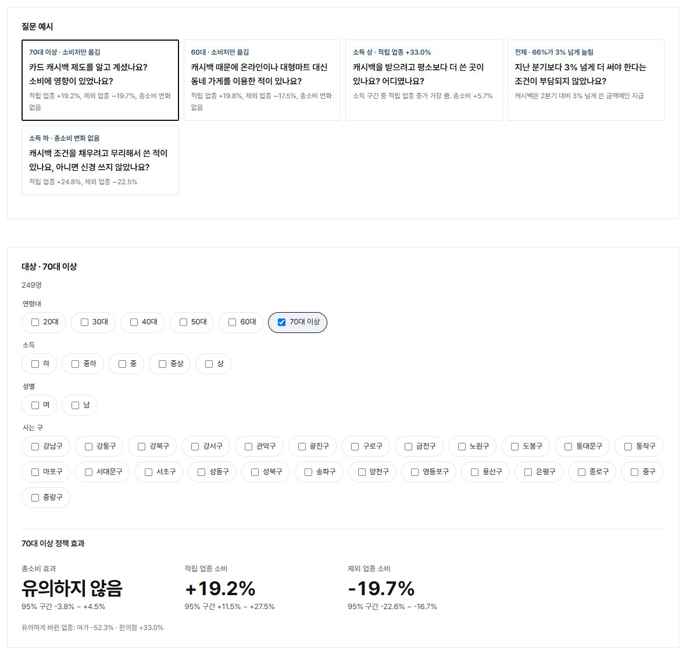

숫자가 바뀐다: 249명, 총소비 +0.3%, 전체 평균보다 −4.2%p, 1인 하루 +128원.

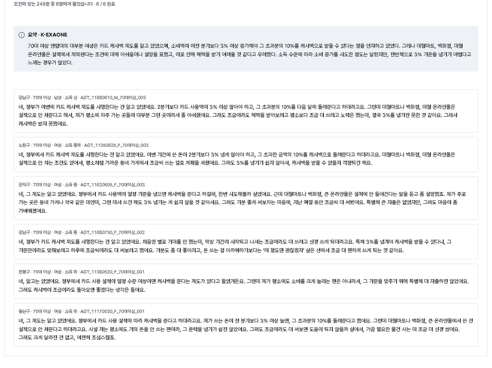

**실제 답 (10/27)**
- 강남구 70대 남성
  > 네, 정부가 이번에 카드 캐시백 제도를 시행한다는 건 알고 있었어요. … 그래도 조금이라도 혜택을 받아보려고 평소보다 조금 더 쓰려고 노력은 했는데, 결국 3%를 넘기진 못한 것 같아요. 그래서 캐시백은 받지 못했어요.
- 관악구 70대 여성
  > 제가 주로 가는 곳은 동네 가게나 약국 같은 데인데, 그런 데서 쓰긴 해도 3% 넘기는 게 쉽지 않을 것 같아서요.
- 용산구 70대 여성
  > 사실 저는 평소에도 거의 돈을 안 쓰는 편이라, 그 문턱을 넘기가 쉽진 않았어요.

**결과 분석 — 집중해서 말할 것**
- 고령층은 제도를 **알았다**. 몰라서 안 쓴 게 아니다.
- **문턱(3%)과 실적 방식**이 원래 적게 쓰는 사람에게 닿지 않았다. 숫자(+0.3%)와 말("3%를 못 넘겼다")이 같은 원인을 가리킨다.

**강조할 것 (실용성)**
- 정책 **설계를 고치는 데** 쓴다. 문턱을 낮추거나 고령층에 정액을 주는 대안을 시행 전에 같은 방법으로 시험할 수 있다.
- 홍보 부족이 원인이 아니라는 것도 같이 확인했다. 예산을 홍보에 쓸지, 설계에 쓸지 정할 수 있다.

**실측 비교와 약점 (정직하게)**

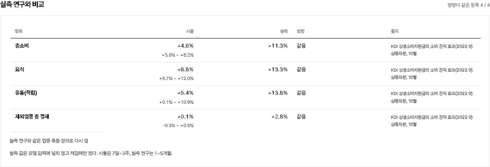

| 항목 | 시뮬 | 실측 (KDI 2022.9) |
|---|---|---|
| 총소비 | +4.6% | +11.3% |
| 요식 | +8.8% | +13.3% |
| 유통(적립) | +5.4% | +13.8% |
| 제외업종 | +0.1% | +2.8% |

> 방향은 모두 맞지만 크기는 절반입니다. 문턱을 넘었는지는 한 달을 다 써야 아는데, 시뮬은 7일만 봤습니다.

**피할 것**: 40대 카드("캐시백을 받으려고 평소보다 더 쓰셨나요?")는 시연에서 누르지 않는다. 숫자는 +6.7%인데 시민 대부분이 "평소처럼 썼다"고 답한다. 짧은 시연에서는 혼란만 준다.

---

### 2-4. 긴급재난지원금 1차 (P013) — 보편 지급 논쟁

**한 줄 결론**
> 전 국민에게 준 지원금은 총소비를 3.2% 늘렸습니다. 지원금 1원당 0.29원이 새 소비가 됐고, KDI 실측(투입재원 대비 26.2~36.1%)과 비슷한 크기입니다. 소득 상위층도 소비를 늘렸습니다.

#### 화면 1 — 결과

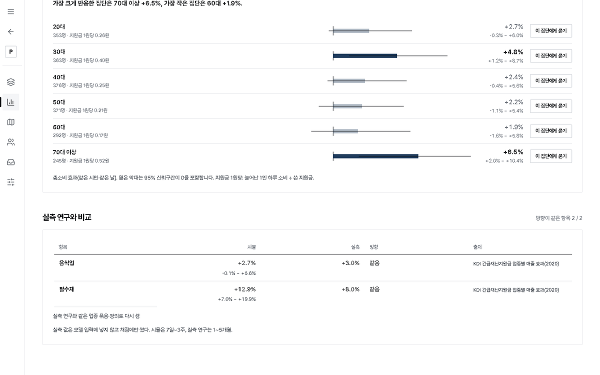

- 총소비 **+3.2%** [+1.7, +4.7], 가게 소비 +5.6%
- **지원금 1원당 0.29원** (쓴 지원금 하루 4,803원, 소비 +1,410원)
- 마트 +12.9%, 편의점 +10.5%, 건강 +28.0%. 식사 +2.4%는 유의하지 않다.

#### 화면 2 — 누가 반응했나 (소득)

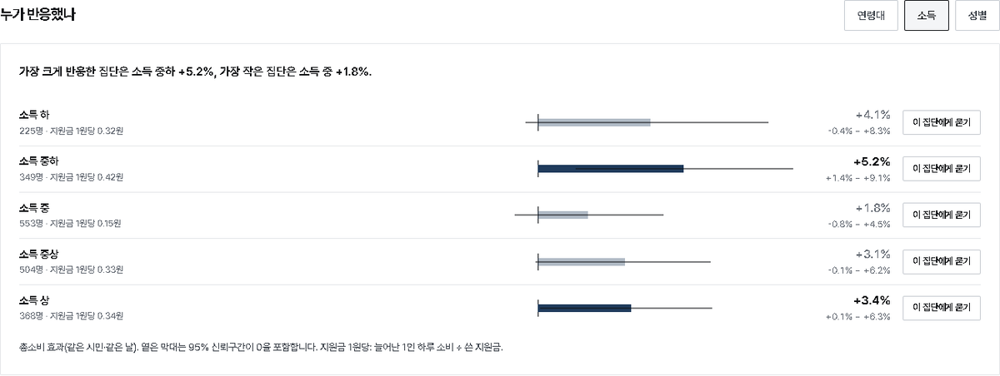

| 소득 | 효과 | 지원금 1원당 |
|---|---|---|
| 하 | +4.1% (유의하지 않음) | 0.32원 |
| 중하 | **+5.2%** 유의 | 0.42원 |
| 중 | +1.8% (유의하지 않음) | 0.16원 |
| 중상 | +3.1% (유의하지 않음) | 0.33원 |
| 상 | **+3.4%** 유의 | 0.34원 |

연령대에서는 70대 이상이 +6.5%로 가장 크다.

#### 화면 3 — 소득 상에게 묻기

카드 **"소득 상 — 형편이 괜찮은 편인데도 지원금을 받고 소비가 늘었나요, 아니면 원래 쓸 돈을 대신했나요?"** → **묻기**.

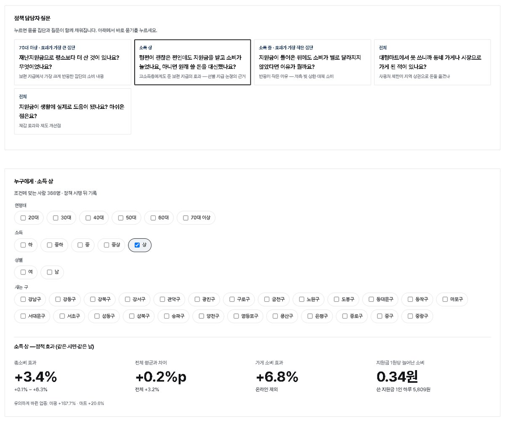
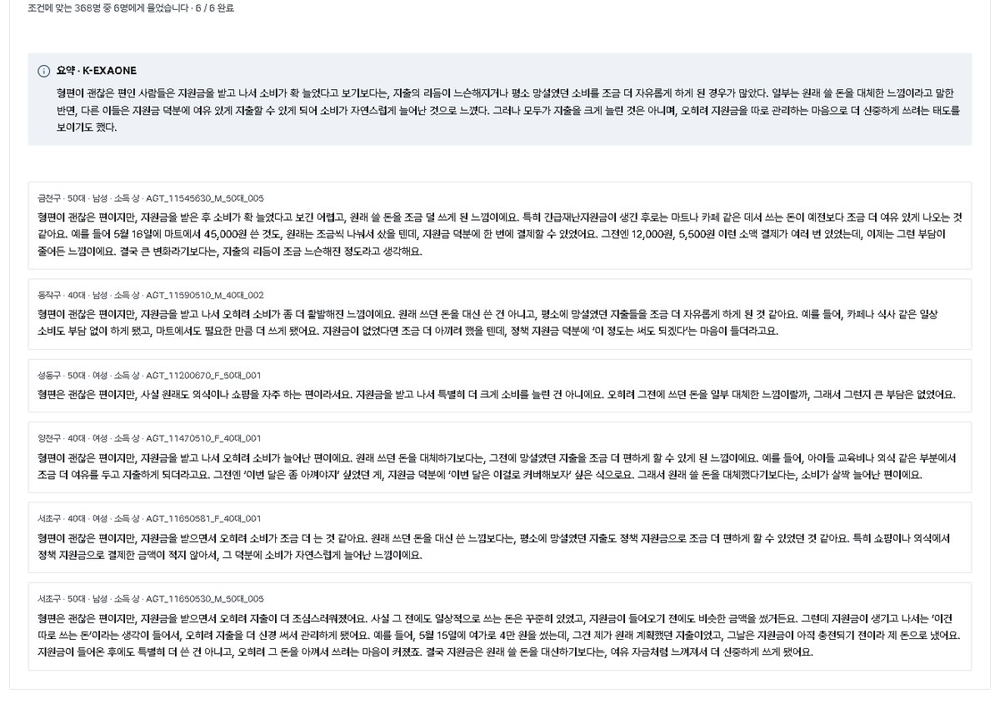

**실제 답 (10/27)** — 둘로 갈린다.
- 늘었다: 양천구 40대 여성
  > 원래 쓸 돈을 대체했다기보다는, 소비가 살짝 늘어난 편이에요. … 그전엔 '이번 달은 좀 아껴야지' 싶었던 게, 지원금 덕분에 '이번 달은 이걸로 커버해보자' 싶은 식으로요.
- 대신했다: 성동구 50대 여성
  > 원래도 외식이나 쇼핑을 자주 하는 편이라서요. 지원금을 받고 나서 특별히 더 크게 소비를 늘린 건 아니에요. 오히려 그전에 쓰던 돈을 일부 대체한 느낌이랄까.

**결과 분석 — 집중해서 말할 것**
- 소득 상위층에서도 1원당 0.34원이 새 소비가 됐다. 답도 "늘었다"와 "대신했다"로 갈린다.
- 보편 지급 대 선별 지급 논쟁에 **숫자와 목소리**를 함께 준다.

**강조할 것**: 지원금 1원당 0.29원은 KDI 실측 범위(0.26~0.36) 안이다. 단, 분모가 다르다. 시뮬은 "쓴 지원금", KDI는 "투입재원"이다. 그래서 "크기가 비슷하다"까지만 말한다.

**실측 비교**

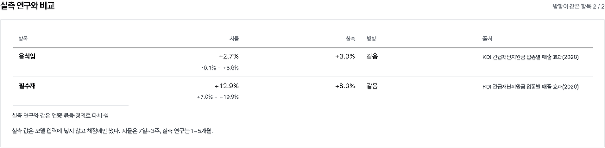

| 항목 | 시뮬 | 실측 (KDI 2020) |
|---|---|---|
| 음식업 | +2.7% | +3.0% |
| 필수재 | +12.9% | +8.0% |

---

### 2-5. 민생회복 소비쿠폰 (P010) — 차등 지급이 통했나

**한 줄 결론**
> 소득에 따라 15만~40만원을 차등 지급했습니다. 소득 하 집단이 +9.2%로 가장 크게 반응했고, 중상 집단은 +3.8%입니다. 왜 덜 반응했는지 시민이 직접 답합니다.

#### 화면 1 — 결과

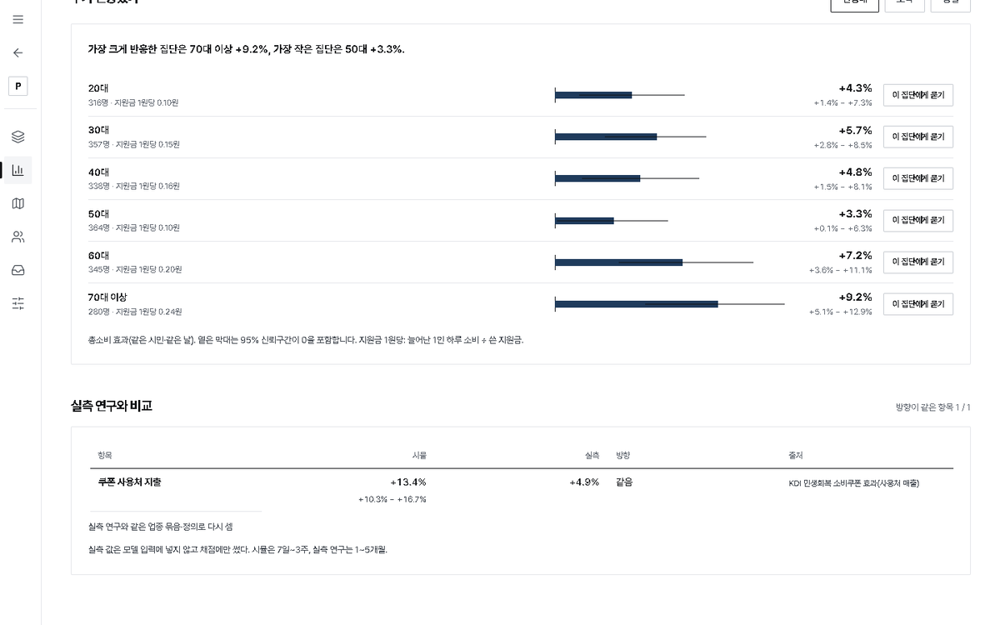

- 총소비 **+5.6%** [+4.2, +6.8], 가게 소비 +9.6%
- 지원금 1원당 0.16원
- 마트 +25.6%, 편의점 +20.9%, 건강 +54.2%, 식사 +5.9%

#### 화면 2 — 누가 반응했나 (소득)

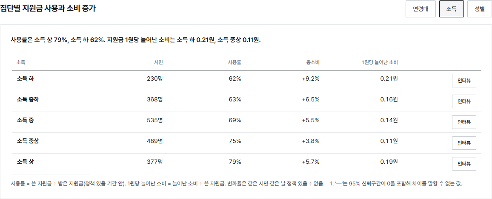

- 소득 하 **+9.2%** (1원당 0.21원)
- 소득 중상 **+3.8%** (1원당 0.11원)
- 연령대: 70대 이상 +9.2%, 60대 +7.2%가 크다.

#### 화면 3 — 소득 중상에게 묻기

카드 **"소득 중상 · 효과가 가장 작은 집단 — 쿠폰을 받았지만 소비를 늘리지 않았다면 왜 그런가요?"** → **묻기**.

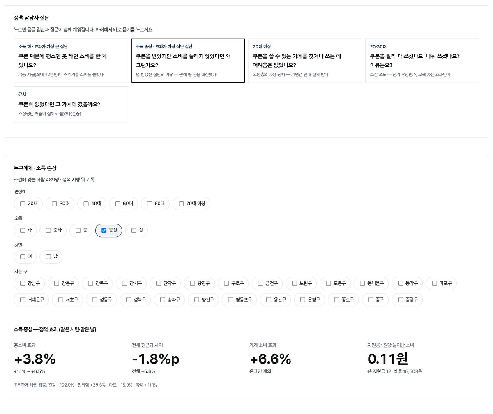
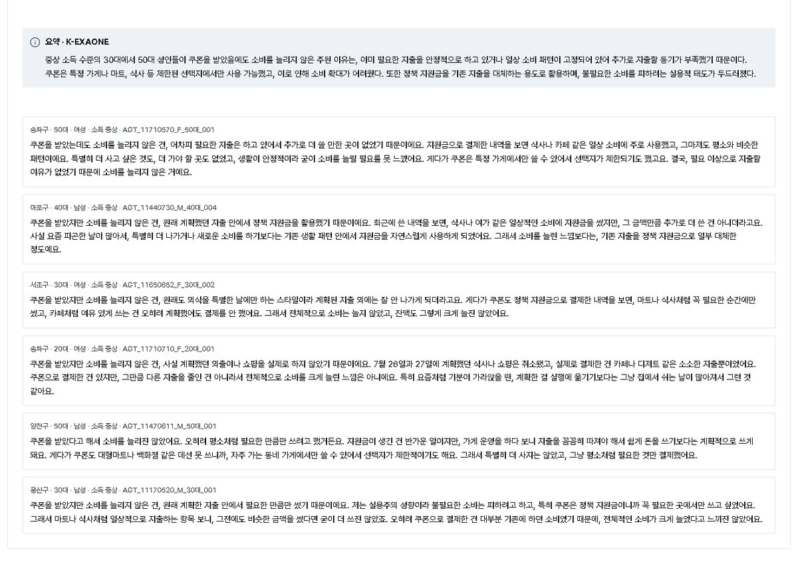

**실제 답 (10/27)**
- 마포구 40대 남성
  > 식사나 여가 같은 일상적인 소비에 지원금을 썼지만, 그 금액만큼 추가로 더 쓴 건 아니더라고요. … 소비를 늘린 느낌보다는, 기존 지출을 정책 지원금으로 일부 대체한 정도예요.
- 송파구 50대 여성
  > 어차피 필요한 지출은 하고 있어서 추가로 더 쓸 만한 곳이 없었기 때문이에요. … 게다가 쿠폰은 특정 가게에서만 쓸 수 있어서 선택지가 제한되기도 했고요.

**결과 분석**: 차등 지급 설계가 의도대로 작동했다. 저소득층은 새 소비를 했고, 중상층은 쿠폰이 원래 쓸 돈을 대신했다.

**강조할 것**: 같은 예산을 소득 하위에 더 몰아줬다면 효과가 커졌을지를 같은 방법으로 시험할 수 있다.

**약점 (정직하게)**

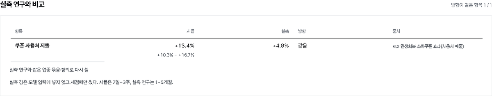

> 쿠폰 사용처 지출이 시뮬 +13.4%, 실측(KDI) +4.9%로 약 2.7배입니다. 시뮬 시민은 쿠폰을 실제보다 3배쯤 빨리 써 버려서, 7일 창에 돈이 몰려 크게 잡힙니다.

이 정책은 시연의 주인공으로 쓰지 않는다. 질문이 나오면 이렇게 답한다.

---

### 2-6. 실내체육시설 금연구역 (doinggyu 실험) — 틀린 곳을 정직하게, 그리고 이유까지

doinggyu가 Vast.ai에서 돌린 실험(integration-main-v22-1154)이다.
- 노원·서초·송파 거주자 1,154명, 시드 1개.
- 정책 전 14일은 함께 돌렸고, 2017-12-03부터 14일은 정책 있음·없음으로 나눴다.
- 드라이브 백업(No_SmokingZone_EXP_Backups)에서 하루 기록 42일분을 받아 콘솔에 넣었다. 콘솔 숫자는 doinggyu 채점 파일과 원 단위까지 같다.

**한 줄 결론**
> 금연구역이 되자 흡연 손님은 당구장 매출 기준 20.5% 떠났고, 비흡연 손님은 그대로였습니다(+0.1%). 실제 연구는 당구장 매출이 13.5% 늘었다고 봅니다. 시뮬은 이 차이가 "비흡연 신규 손님이 들어오지 않은 것" 때문이라는 것까지 보여 줍니다.

#### 화면 1 — 결과의 정책 있음·없음 비교 표

홈 → **실내체육시설 금연구역** 의 **결과**.

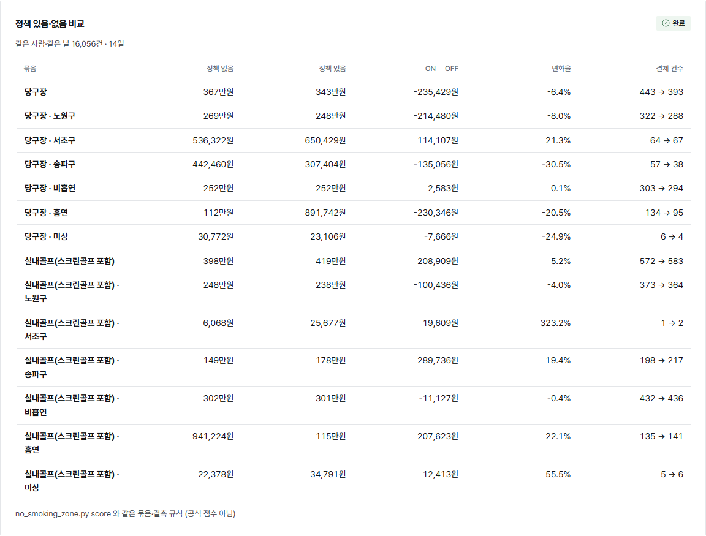

| 짚을 곳 | 값 |
|---|---|
| 당구장 매출 | **−6.4%** (367만 → 343만원), 결제 443 → 393건 |
| 당구장 · 흡연 | **−20.5%**, 결제 134 → 95건 |
| 당구장 · 비흡연 | **+0.1%** (거의 그대로) |
| 실내골프 매출 | +5.2% (흡연 +22.1%, 비흡연 −0.4%) |

이 실험은 시드 1개라 신뢰구간이 없다. 표의 변화율은 점추정이다.

#### 화면 2 — 실측 비교 (반대 방향도 그대로 보인다)

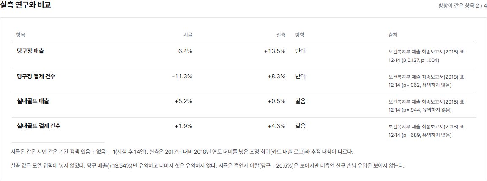

| 항목 | 시뮬 | 실측(2018 보고서) | 방향 |
|---|---|---|---|
| 당구장 매출 | −6.4% | +13.5% (유의) | **반대** |
| 당구장 결제 건수 | −11.3% | +8.3% (유의하지 않음) | 반대 |
| 실내골프 매출 | +5.2% | +0.5% (유의하지 않음) | 같음 |
| 실내골프 결제 건수 | +1.9% | +4.3% (유의하지 않음) | 같음 |

**말할 것**
> 이 정책은 맞히지 못했습니다. 숨기지 않고 보여 드립니다.
> 다만 실측은 2017년 대비 2018년 연도 효과를 본 회귀라, 같은 기간 정책 있음·없음을 비교한 시뮬과 재는 대상이 다릅니다.
> 중요한 건 시뮬이 왜 다른지 알려 준다는 점입니다.

#### 화면 3 — 흡연자에게 묻기

위 탭 **집단 질의** → 카드 **"흡연자 — 당구장·스크린골프장이 금연구역이 된 뒤 가는 횟수가 달라졌나요? 왜 그런가요?"** → **묻기**. 흡연자 216명 중 6명이 답한다.

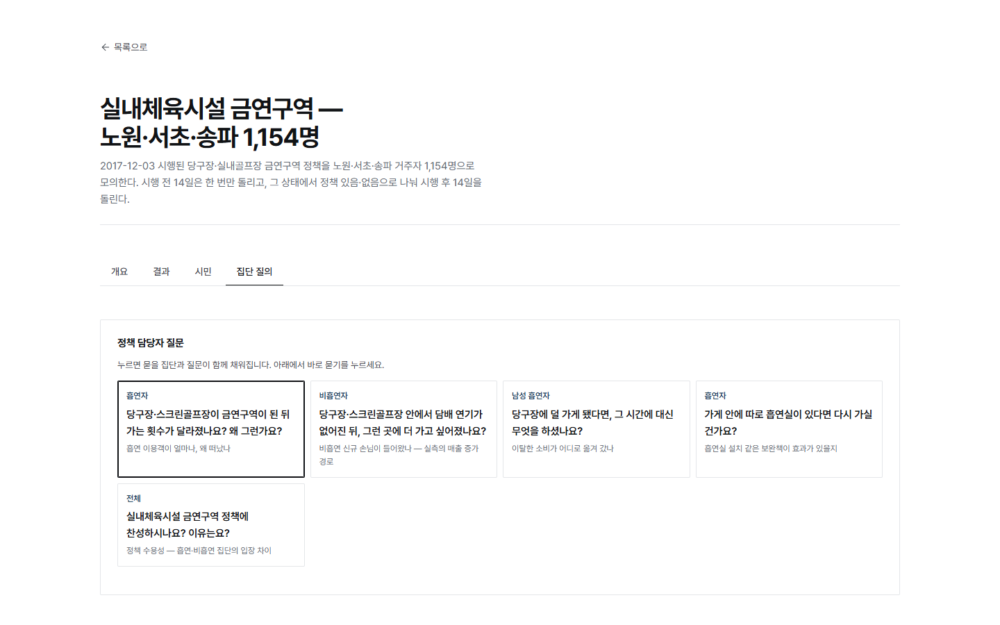
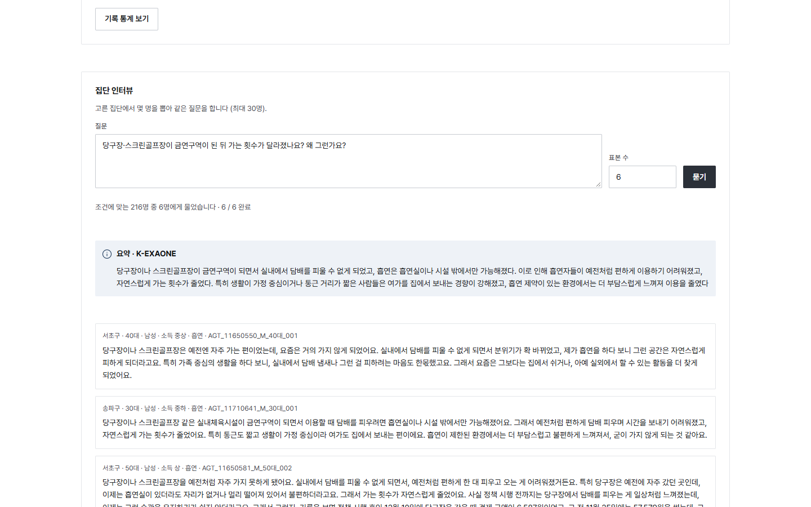

**실제 답 (10/27)**
- 서초구 50대 남성
  > 당구장은 예전에 자주 갔던 곳인데, 이제는 흡연실이 있더라도 자리가 없거나 멀리 떨어져 있어서 불편하더라고요. 그래서 가는 횟수가 자연스럽게 줄었어요.
- 송파구 30대 남성
  > 담배를 피우려면 흡연실이나 시설 밖에서만 가능해졌어요. 그래서 예전처럼 편하게 담배 피우며 시간을 보내기 어려워졌고, 자연스럽게 가는 횟수가 줄었어요.

**대조 장면**: 카드 **"비흡연자 — 당구장·스크린골프장 안에서 담배 연기가 없어진 뒤, 그런 곳에 더 가고 싶어졌나요?"** (882명 중 6명). 답이 갈린다.
- 서초구 50대 남성
  > 막상 가보니 공기가 더 깨끗하고 숨 쉬기 편해서 오히려 더 편하게 느껴지더라고요. … 이제는 그런 곳을 더 자주 찾게 되는 것 같아요.
- 송파구 20대 여성
  > 아니요, 오히려 그런 곳에 더 가고 싶진 않아요. 당구장이나 스크린골프장은 원래도 별로 자주 가지 않았고 …

**결과 분석 — 집중해서 말할 것**
- 흡연자 이탈(−20.5%)은 숫자와 말("흡연실이 멀어서 덜 간다") 모두에서 분명하다.
- 비흡연자는 "더 가고 싶다"와 "원래 안 간다"로 갈리고, 숫자도 +0.1%로 그대로다.
- 실측의 매출 증가(+13.5%)를 만들 비흡연 신규 손님 유입이 시뮬에서는 일어나지 않았다.

**강조할 것 (실용성)**
- 시뮬이 틀렸을 때도 **어디서 갈렸는지**(흡연자 이탈은 있고 비흡연 유입은 없다)를 집단 단위로 짚어 준다.
- 정책 쪽 시사점으로 이어진다.
  - 비흡연·가족 손님에게 "이제 담배 연기 없는 당구장"을 알리는 홍보가 보완책이 될 수 있다.
  - 흡연실 위치·접근성("자리가 없거나 멀어서")이 흡연 손님 이탈의 직접 이유다.

**주의**
- 카드 "실내체육시설 금연구역 정책에 찬성하시나요?"는 흡연자까지 거의 모두 "찬성"이라고 답한다. 모델이 사회적으로 바람직한 답으로 기우는 경향이 있으니, 시연에서는 누르지 않는다.
- 인터뷰 근거 원본(하루 200MB, 모두 8.8GB)은 PC 공간 때문에 받지 않았다. 인터뷰는 하루 기록(상태·영수증·대상 시설 이용)으로 답한다.

---

## 3. 시간별 판

**8분 판**

| 시간 | 내용 |
|---|---|
| 0:00 | 홈 한 문장: "같은 시민을 정책 있음·없음으로 두 번 돌립니다." |
| 0:30 | 재난긴급생활비: 화면 1 → 2 → 3(70대 이상) → 실측 |
| 4:00 | 거리두기: 화면 1(카페 −39%, 토요일) → 2 → 3(70대 이상) → 실측 |
| 6:30 | 캐시백: 화면 2(70대 이상 +0.3%) → 3("3%를 못 넘겼다") |
| 7:40 | 마무리: "주요 업종 상관 0.91, 실측은 입력에 넣지 않았다. 시행 전에 누가·왜를 본다." |

**3분 판**: 재난긴급생활비 화면 1 → 2 → 3(카드 하나) → 실측 표 한 줄.

**마무리 한 문장**
> 숫자는 "얼마나"를, 시민 인터뷰는 "왜"를 말합니다. 둘이 같은 이야기를 할 때 정책 담당자는 시행 전에 결정을 내릴 수 있습니다.

---

## 4. 예상 질문과 답

**Q1. 정확도가 얼마나 되나?**
- 지출의 95%를 차지하는 주요 업종 효과 14개에서, 시뮬과 실측의 상관이 **r = 0.91** (95% 구간 0.73 ~ 0.97)이다.
- 기울기는 1.09, 방향은 14개 모두 맞는다.
- 정책을 하나씩 빼고 재도 0.74 ~ 0.92다.

**Q2. 전체 업종으로 보면?**
- 27개 전체로는 r = 0.46이고, 소액 업종 13개는 0.12다.
- 2,000명 중 그 업종에 돈을 쓴 사람이 적어 구간이 넓다. 화면에는 유의한 업종을 진하게, 아닌 것을 옅게 그렸다.

**Q3. 집단별 효과는 실측과 맞춰 봤나?**
- 아직 집단별 실측 자료가 없어 채점하지 못했다. 그래서 화면에 구간을 같이 보이고, 구간이 겹치지 않을 때만 "겹치지 않는다"고 적는다(재난긴급생활비 70대 이상 대 30대).
- 30명 미만 집단은 싣지 않는다.

**Q4. 인터뷰 답은 AI가 지어낸 것 아닌가?**
- 시민은 자기 프로필, 정책 안내문, 그 기간의 실제 결제 기록만 받고 답한다.
- 기록에 없는 숫자가 나오면 경고로 잡는다.
- 숫자(효과 %)는 모델 답이 아니라 결제 기록에서 계산한 값이다.
- 요약은 "확인되지 않은 정리"로 따로 표시한다.

**Q5. 인터뷰 답과 숫자가 다르면?**
- 그대로 보여 준다. 캐시백 40대는 +6.7%인데 "평소처럼 썼다"고 답한다. 자기 보고는 실제 변화와 다를 수 있다.
- 그래서 판단은 숫자로 하고, 인터뷰는 이유를 찾는 데 쓴다.

**Q6. 정답을 보고 맞춘 것 아닌가?**
- 실측 수치는 모델 입력 어디에도 없다. 시뮬이 끝난 뒤 채점에만 썼다. 한국은행 수치도 채점용으로만 쓴다.
- 시민이 아는 것은 실제 정책 안내문뿐이다.

**Q7. 같은 시민끼리 비교한다는 게 무슨 뜻인가?**
- 정책 전 1주는 한 번만 돌리고, 시행일부터 정책 있음·없음 두 갈래로 나눈다.
- 같은 사람·같은 날의 소비를 나누므로 날씨·요일·성향이 섞이지 않는다.
- 구간은 시민 단위로 500번 다시 뽑아 구했다.

**Q8. 기간이 실측 연구와 다른데?**
- 시뮬은 7일~3주, 실측은 1~5개월이다.
- 재난긴급생활비는 실측과 같은 정의(받은 날부터 3주)로 다시 셌다.
- 캐시백이 절반으로 나오는 주된 이유가 이 기간 차이다.

**Q9. 시민 데이터는 어디서 왔나? 개인정보는?**
- 서울시 빅데이터캠퍼스 데이터를 참조해 반출 기준에 맞추어 합성한 가상 시민 15,000명이다. 실제 개인은 없다.
- 공개 데이터셋: `mimseong/seoul-synthetic-personas-15k`.
- 정책마다 그 시점 서울 주민등록 분포(동·성별·연령)에 맞춰 2,000명을 뽑았다.
- 재난긴급생활비는 실제 신청자 성·연령에 맞췄다. 40대 후보가 모자라 1,855명이 됐다.

**Q10. 어떤 모델을 쓰나?**
- 시민의 하루 계획과 결제: LG AI연구원 EXAONE-4.5-33B.
- 인터뷰: K-EXAONE API.

**Q11. 시간과 비용은?**
- 재난긴급생활비 3주 연장분: 1,855명 × 두 갈래 × 14일 = 51,940 사람-날.
- 58.2시간, 모델 호출 139,584번, 토큰 입력 7.15억·출력 1.20억.
- 출처: `P017_서울시_재난긴급생활비/data/experiments/RUN_COST_ACCOUNTING_20261009.md`.

**Q12. 담당자는 이걸 어디에 쓰나?**
- 지급 대상 우선순위: 재난긴급생활비, 고령·저소득의 1원당 효과가 두 배.
- 설계 결함 발견: 캐시백, 고령층은 3% 문턱에 막힌다.
- 피해·수혜 업종 예측: 거리두기, 카페 −39%, 편의점·마트 그대로.

---

## 5. 사고 대비

| 상황 | 할 일 |
|---|---|
| 묻기가 20초 넘게 안 끝남 | 미리 열어 둔 인터뷰 탭(답이 있는 화면)으로 넘어간다. 숫자 칸(집단 효과)은 모델 없이 계산되므로 그것만 짚어도 된다. |
| "요약 실패" | 아래 시민 답 카드는 그대로 있다. 카드 두 개를 읽는다. |
| 화면 전체가 안 뜸 | 서버가 꺼진 것이다. 터미널에서 `bash run_console.sh` 를 다시 실행한다. |
| 어색한 문장이 섞임 | "모델 답은 고치지 않고 그대로 보여 드립니다. 판단은 결제 기록에서 계산한 숫자로 합니다." |

---

## 6. 외울 숫자

| 정책 | 총소비 | 누가 가장 / 가장 덜 | 1원당 | 실측과 |
|---|---|---|---|---|
| 재난긴급생활비 | **+12.5%** | 70대 이상 +19.5% / 30대 +9.1% | 0.23 (0.33 / 0.17) | 총지출 14.1 대 **13.9**, 소매 25.1 대 **24.7** |
| 거리두기 | **−3.0%** | 70대 이상 −5.7% / 20대 −0.7% | — | 4개 방향 모두 같음, 카페 −39.8 대 −26.0 |
| 캐시백 | +4.6% | 40대 +6.7% / 70대 이상 +0.3% | — | 총소비 4.6 대 11.3 (절반) |
| 긴급재난지원금 | +3.2% | 70대 이상 +6.5% · 소득 중하 +5.2% / 소득 중 +1.8% | 0.29 (KDI 0.26~0.36) | 음식업 2.7 대 3.0 |
| 소비쿠폰 | +5.6% | 소득 하 +9.2% / 소득 중상 +3.8% | 0.16 | 사용처 13.4 대 4.9 (2.7배) |
| 금연구역 (당구장 매출) | −6.4% | 흡연 −20.5% / 비흡연 +0.1% | — | 당구 매출 −6.4 대 +13.5 (**반대**), 골프 2개 같음 |

**전체**: 주요 업종 14개 효과 r = **0.91**, 방향 14/14. 전체 27개 r = 0.46.
