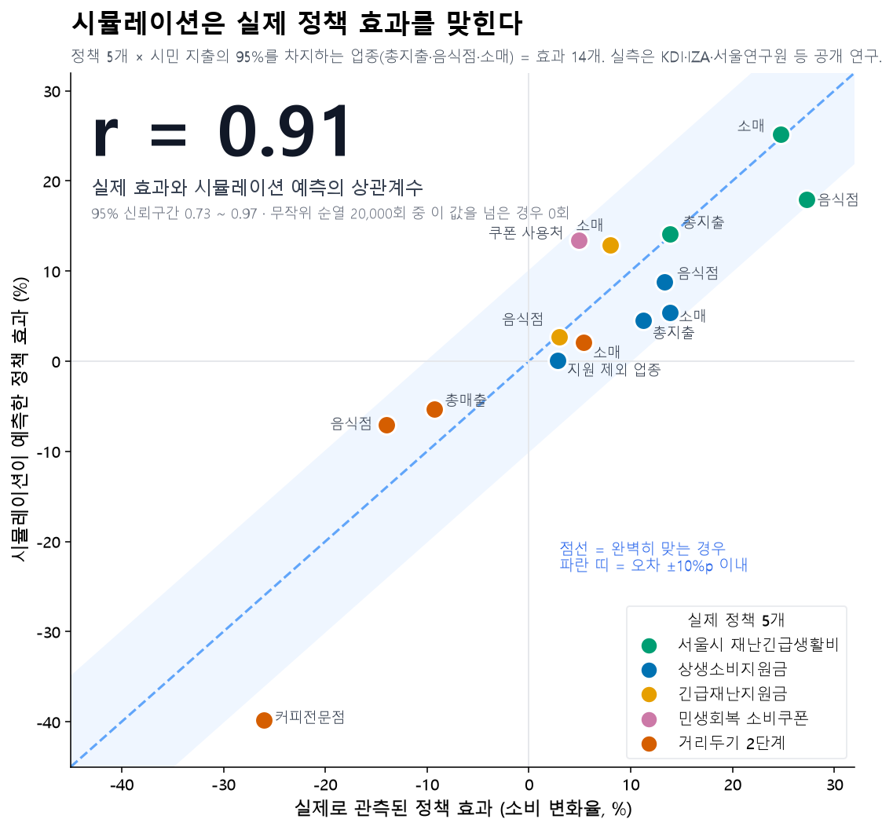

# 시뮬레이션 성능 평가 — r = 0.91

**실제 정책 5개에서 시민 지출의 95%를 차지하는 업종 효과 14개를 시뮬레이션이 r = 0.91로 맞혔다.**
95% 신뢰구간은 0.73 ~ 0.97이다. 실측을 무작위로 섞은 20,000번 중 이 값을 넘은 경우는 0번이었다.

## 무엇을 쟀나

- **비교한 것**: 같은 시민을 정책이 있는 세계와 없는 세계로 각각 시뮬레이션해서 소비 변화율(정책 효과)을 구했다. 이 값을 실제 정책 효과를 추정한 공개 연구(KDI · IZA · 서울연구원 · 한국신용데이터 등)와 짝지었다.
- **실측 값의 쓰임**: 실측 값은 모델 입력에 넣지 않았다. 채점에만 썼다.
- **정책 5개**:
  - P017 서울시 재난긴급생활비
  - P012 상생소비지원금
  - P013 긴급재난지원금
  - P010 민생회복 소비쿠폰
  - 거리두기 2단계 격상
- **효과 14개를 고른 기준**: 총지출, 음식점·카페, 소매처럼 시민 지출의 95.4%가 몰리는 업종이다. 정책이 없는 세계에서도 시민 71 ~ 100%가 이 업종에서 결제한다. 효과의 크기를 정하는 곳이 이 업종들이다.
- **상관계수 r**: 1이면 시뮬이 실제 효과의 크고 작음을 완벽히 따라간다는 뜻이고, 0이면 무관하다는 뜻이다. 시뮬 효과와 실측 효과의 기울기는 1.09로, 크기 눈금도 실측과 같았다.

## 선행 연구와 비교

| 연구 | 무엇을 맞혔나 | 결과 |
|---|---|---|
| **이 연구** | 실제 시행된 정책 5개의 카드 소비 효과 | **r = 0.91** |
| Hewitt 외 (2024, 스탠퍼드) | 온라인 설문 실험 70개의 처치효과(GPT-4) | r = 0.85 |
| AgentSociety (2025, 칭화대, 에이전트 1만 명) | 기본소득 등 사회 실험 | 수치 검증 없음("비슷하다"는 서술) |

과제가 달라 순위를 매기는 비교는 아니다.

## 자세히 (전체 27개 · 계산 · 한계)

| 범위 | 효과 수 | 피어슨 r (95% 신뢰구간) |
|---|---|---|
| 주요 업종 (지출 95%) | 14 | **0.91** (0.73 ~ 0.97) |
| 소액 업종 (상품 · 서비스, 지출 5%) | 13 | 0.12 (−0.45 ~ 0.73) |
| 전체 | 27 | 0.46 (−0.07 ~ 0.82) |

- **전체 27개에는 금연구역 실험(효과 2개)도 들어 있다.** 소액 업종에는 학원, 가전, 의료, 의류, 여가가 있다. 결제한 시민이 4 ~ 27%뿐이라 시민 2,000명으로는 시뮬 쪽 추정이 크게 흔들린다(시뮬 95% 신뢰구간 폭이 수십 %p에 이른다).
- **시뮬 표본오차를 보정하면 신뢰구간이 있는 25개의 상관은 0.83이다**(희석 보정).
- **계산 방법**
  - 효과는 로그 변화 ln(1 + x)로 통일했다. 그림은 읽기 쉽게 %로 표시했다.
  - 신뢰구간은 효과 쌍 단위 부트스트랩 10,000회로 구했다.
  - p값은 실측을 섞는 순열 검정 20,000회로 구했다.
- **한계**
  - 실측 연구와 시뮬의 비교 기간이 다르다. 시뮬은 7일 ~ 3주, 실측은 1 ~ 5개월이다.
  - 업종 묶음과 주요 업종 기준은 결과를 본 뒤 정했다. 그래서 전체 27개 값을 함께 공개한다.
  - 정책 하나를 빼고 계산해도 r은 0.74 ~ 0.92를 유지한다.

## 재현

- `eval_unified.py`: 27쌍 구성과 지표 계산.
- `eval_tiers.py`: 주요 / 소액 업종 구분.
- `make_hero.py`: 그림.
- 결과 파일: `pairs_grouped.csv`, `tiers.json`.
- 입력: 각 본런 채점 파일과 원장(구글 드라이브 `KW_시뮬결과_공유_20261011`).
